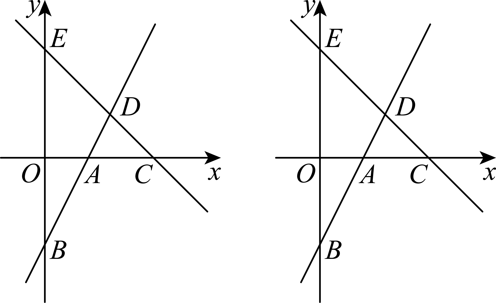

# Mathematics - 题目 604

**ID**: b8befa17be974ac283141d2ccb7318a3
**年级**: Grade 8
**难度**: Medium-Hard
**题型**: Calculation

## 题目
已知直线 $l{{}_{1}}$ ： $y=2x-4$ 与x轴、y轴分别交于点A、B，直线 $l{{}_{2}}$ ： $y=-x+5$ 与x轴、y轴分别交于点C、E，两直线交于点 $D$ ．（1）求点D的坐标；​​​​​​​‌（2）在x轴上是否存在点P，使得 $\mathrm{△}BPD$ 为等腰三角形？若存在，求出所有符合条件的点P坐标；若不存在，请说明理由；（3）在直线 $l{{}_{1}}$ 上有一点Q，使得 $\angle CQD=45{}\degree $ ，请直接写出满足条件的点Q坐标，不必说明理由．

## 解答

1. （1）解：联立两直线解析式可得：
2. $\begin{cases}y=2x-4\\y=-x+5\end{cases}$ ，
3. 解得 $\begin{cases}x=3\\y=2\end{cases}$ ，
4. 则点D的坐标为 $D\left ({3,2}\right )$  $\left ({3,2}\right )$ ；
5. （2）解：直线 $l{{}_{1}}$ ： $y=2x-4$ 与x轴、y轴分别交于点A、B，
6. 则 $A\left ({2,0}\right )$ ， $B\left ({0,-4}\right )$ ，
7. 设 $P\left ({p，0}\right )$ ，
8. 则 $PB{^{2}}=p{^{2}}+16$ 、 $PD{^{2}}={\left({p-3}\right)^{2}}+4$ 、 $BD{^{2}}=3{^{2}}+{\left({2+4}\right)^{2}}=45$ ，
9. ①当 $PB=PD$ 时，则 $p{^{2}}+16={\left({p-3}\right)^{2}}+4$ ，
10. 解得 $p=-\frac {1}{2}$ ，
11. 则点 $P$ 的坐标为 $P\left ({-\frac {1}{2},0}\right )$ ；
12. ②当 $PB=BD$ 时，则 $p{^{2}}+16=45$ ，
13. 解得 $p=\pm \sqrt {29}$ ，
14. 则点 $P$ 的坐标为 $\left ({\sqrt {29},0}\right )$ 或 $\left ({-\sqrt {29},0}\right )$ ；
15. ③当 $PD=BD$ 时，则 ${\left({p-3}\right)^{2}}+4=45$ ，
16. 解得 $p=\pm \sqrt {41}+3$ ， $p=\pm \sqrt {41}+3$
17. 则点 $P$ 的坐标为 $\left ({\sqrt {41}+3,0}\right )$ 或 $\left ({-\sqrt {41}+3,0}\right )$ ；
18. 综上，P的坐标为 $\left ({-\frac {1}{2},0}\right )$ 或 $\left ({\sqrt {29},0}\right )$ 或 $\left ({-\sqrt {29},0}\right )$ 或 $\left ({\sqrt {41}+3,0}\right )$ 或 $\left ({-\sqrt {41}+3,0}\right )$ ；
19. （3）解：直线 $l{{}_{1}}$ ： $y=2x-4$ 与x轴交于点A，
20. 则点 $A$ 的坐标为 $A\left ({2，0}\right )$ ，
21. 直线 $l{{}_{2}}$ ： $y=-x+5$ 与x轴交于点C，
22. 则点 $C$ 的坐标为 $C\left ({5，0}\right )$ ，
23. 则 $AC=3$ ，
24. 由（1）知，点 $D$ 的坐标为 $D\left ({3,2}\right )$ ，
25. $\therefore AD=\sqrt {5}$ ，
26. 过C作 $CG\bot AD$ 于点G，
27. $S{{}_{\vartriangle ACD}}=\frac {1}{2}\times AC\times y{{}_{D}}=\frac {1}{2}\times AD\times CG$ ，
28. 则 $CG=\frac {AC\times y{{}_{D}}}{AD}=\frac {3\times 2}{\sqrt {5}}=\frac {6\sqrt {5}}{5}$ ，
29. 由于 $\angle CQD=45{}\degree $ ，
30. 则 $\vartriangle CGQ$ 为等腰直角三角形，
31. $CQ{^{2}}=CG{^{2}}+GQ{^{2}}=2CG{^{2}}=\frac {72}{5}$
32. 设 $Q\left ({m,2m-4}\right )$ ，则 $CQ{^{2}}={\left({m-5}\right)^{2}}+{\left({2m-4}\right)^{2}}=5m{^{2}}-26m+41=\frac {72}{5}$
33. 整理得 $25m{^{2}}-130m+133=0$ ，
34. 解得 $m=\frac {19}{5}$ 或 $\frac {7}{5}$ ，
35. 因此，点 $Q$ 的坐标为 $\left ({\frac {19}{5},\frac {18}{5}}\right )$ 或 $\left ({\frac {7}{5},-\frac {6}{5}}\right )$ ．

## 知识点

**中文**:
  - 一次函数与二元一次方程（组）
  - 一次函数的图象和性质
  - 等腰三角形的性质

**English**:
  - Linear Functions and Systems of Linear Equations
  - Graphs and Properties of Linear Functions
  - Properties of Isosceles Triangles

---
