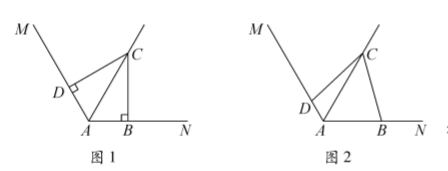

# Mathematics - 题目 2666

**ID**: bada02bf46dc47219319b685a7afd5e0
**年级**: Grade 8
**难度**: Medium-Hard
**题型**: Calculation

## 题目
已知 $\angle MAN=120{}^\circ $ ， $AC$ 平分 $\angle MAN$ ，点 $B,D$ 分别在 $AN,AM$ 上．（1）如图1，若 $CD\bot AM$ 于点 $D$ ， $CB\bot AN$ 于点 $B$ ．①利用等腰三角形“三线合一”，将 $ΔADC$ 补成一个等边三角形，可得 $AC,AD$ 的数量关系为．②请问： $AC$ 是否等于 $AB+AD$ 呢？如果是，请予以证明．（2）如图2，若 $\angle ABC+\angle ADC=180{}^\circ $ ，则（1）中的结论是否仍然成立？若成立，请予以证明；​​​​​​​‌若不成立，请说明理由．

## 解答

1. 解：（1）① $AD=\frac {1}{2}AC$ （或 $AC=2AD$ ）
2. $\because AC$ 平分 $\angle MAN,\angle MAN=120{}^\circ $ ，
3. $\therefore \angle CAD=60{}^\circ $ ，又 $\angle ADC=90{}^\circ $ ，
4. $\therefore \angle ACD=30{}^\circ $
5. 利用等腰三角形“三线合一”，将 $ΔADC$ 补成一个等边三角形，可知
6. $AD=\frac {1}{2}AC$
7. ② $AD+AB=AC$
8. 证明：由①知， $AD=\frac {1}{2}AC$
9. 同理， $\because AC$ 平分 $\angle MAN,\angle MAN=120{}^\circ $ ，
10. $\therefore \angle CAB=60{}^\circ $ ，又 $\angle ABC=90{}^\circ $ ，
11. $\therefore \angle ACB=30{}^\circ $ , $AB=\frac {1}{2}AC$
12. $\therefore AD+AB=AC$
13. （2）仍成立
14. 证明：过点 $C$ 分别作 $AM,AN$ 的垂线，垂足分别为 $E,F$
15. 
16. $\because AC$ 平分 $\angle MAN,$
17. $\therefore CE=CF$ ，
18. $\because \angle ABC+\angle ADC=180{}^\circ ,\angle ADC+\angle CDE=180{}^\circ $
19. $\therefore \angle CDE=\angle ABC$
20. 又 $\angle CED=\angle CFB=90{}^\circ $
21. $\therefore ΔCED\cong ΔCFB\left ({AAS}\right )$
22. $\therefore ED=FB$
23. $\therefore AD+AB=AE-ED+AF+FB=AE+AF$
24. 由（1）中②知 $AE+AF=AC$
25. $\therefore AD+AB=AC$ ．

## 知识点

**中文**:
  - 全等三角形的性质
  - 角角边(AAS)
  - 含30度角的直角三角形

**English**:
  - Properties of Congruent Triangles
  - AAS (Angle-Angle-Side)
  - Right Triangle with 30° Angle

---
