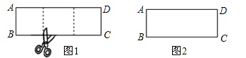

# Mathematics - 题目 13

**ID**: bd4535a4e2b54178949d44c11cc9cb38
**年级**: Grade 8
**难度**: Medium-Hard
**题型**: Calculation

## 题目
一张矩形纸片，剪下一个正方形，剩下一个矩形，称为第一次操作；​​​​​​​‌在剩下的矩形纸片中再剪下一个正方形，剩下一个矩形，称为第二次操作；……；若在第 $n$ 次操作后，剩下的矩形为正方形，则称原矩形为 $n$ 阶奇异矩形．如图1，矩形 $ABCD$ 中，若 $AB=2$ ， $BC=6$ ，则称矩形 $ABCD$ 为2阶奇异矩形．（1）判断与操作：如图2，矩形 $ABCD$ 的长为5，宽为2，它是奇异矩形吗？如果是，请写出它是几阶奇异矩形，并在图中画出裁剪线；如果不是，请说明理由．（2）探究与计算：已知矩形 $ABCD$ 的一边长为20，另一边长为 $a(a<20)$ ，且它是3阶奇异矩形，请画出矩形 $ABCD$ 及裁剪线的示意图，并在图的下方写出 $a$ 的值．

## 解答

1. ：（1）矩形 $ABCD$ 是3阶奇异矩形，裁剪线的示意图如下：
2. 
3. （2）裁剪线的示意图如下：
4. 

## 知识点

**中文**:
  - 矩形的性质

**English**:
  - Properties of Rectangles

---
