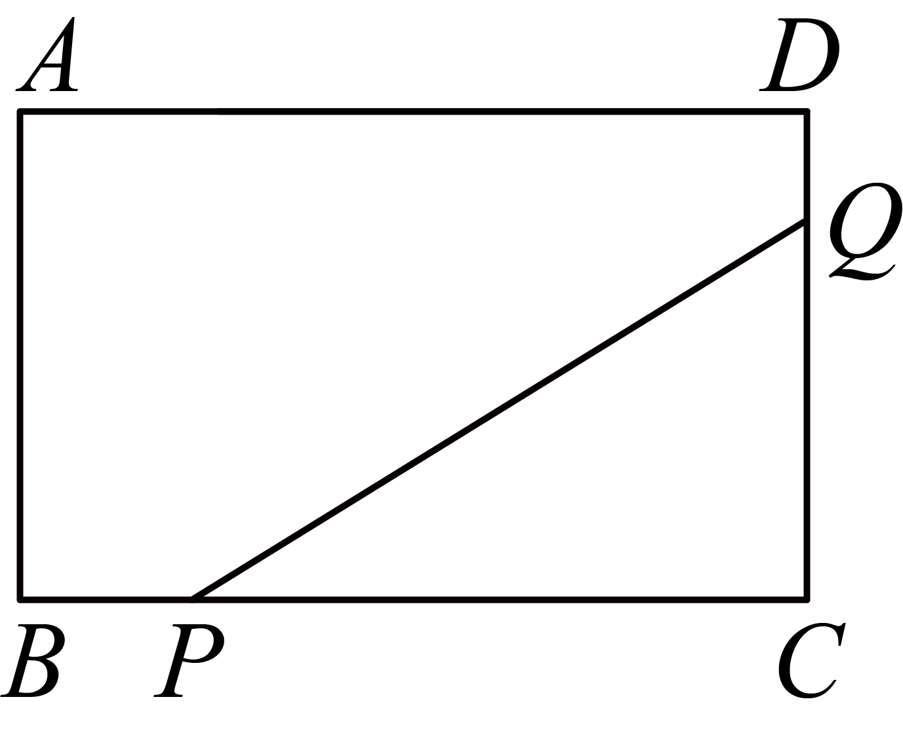

# Mathematics - 题目 2783

**ID**: c14496450f5c4204b89caab00d2555ce
**年级**: Grade 8
**难度**: Medium-Hard
**题型**: Calculation

## 题目
如图，在长方形 $ABCD$ 中， $AB=10$ ， $BC=14$ ．动点 $P$ 从点 $B$ 出发，以每秒 $2$ 个单位长度的速度沿 $BC$ 向终点 $C$ 运动；​​​​​​​‌同时动点 $Q$ 从点 $C$ 出发，以每秒 $4$ 个单位长度的速度沿 $CD-DA$ 向终点 $A$ 运动，连结 $PQ$ ．设点 $P$ 的运动时间为 $t$ 秒( $t>0$ )．（1）当点 $Q$ 在 $CD$ 边上时，线段 $DQ$ 的长为 $\_\_\_\_\_\_$ ；(用含 $t$ 的代数式表示)当点 $Q$ 在 $AD$ 边上时，线段 $DQ$ 的长为 $\_\_\_\_\_\_$ ；(用含 $t$ 的代数式表示)（2）当线段 $PQ$ 将长方形 $ABCD$ 分割后，所得图形中存在轴对称图形时，求 $t$ 的值；（3）若点 $Q$ 到达点 $A$ 后，立即以原速度的 $5$ 倍返回到点 $D$ ，同时点 $P$ 以原速度继续向终点 $C$ 运动．在点 $Q$ 的整个运动过程中，作点 $Q$ 关于点 $D$ 的中心对称点 $Q^{′}$ ，当 $△PQQ^{′}$ 的面积是 $\vartriangle PCD$ 面积的 $5$ 倍时，直接写出 $t$ 的值．

## 解答

1. （1）解：（1）当点 $Q$ 在 $CD$ 边上时， $0<t<2.5$ ，
2. $\because CQ=4t,CD=AB=10$ ，
3. $\therefore DQ=CD-CQ=10-4t$ ；
4. 当点 $Q$ 在 $AD$ 边上时， $2.5<t<6$ ，
5. $DQ=4t-CD=4t-10$ ．
6. 故答案为： $10-4t$ ； $4t-10$ ；
7. （2）①当点 $Q$ 在 $CD$ 边上时， $0<t<2.5$ ，
8. 由题意得： $BP=2t,$
9. $\therefore PC=BC-BP=14-2t$ ．
10. 当 $PC=CQ$ 时， $\vartriangle PCQ$ 为等腰直角三角形，是轴对称图形，
11. $\therefore 14-2t=4t$ ，
12. $\therefore t=\frac {7}{3}$ ．
13. ②当点 $Q$ 在 $AD$ 边上时， $2.5<t<6$ ，
14. 当 $PC=DQ$ 时，四边形 $PCDQ$ 为长方形，是轴对称图形，
15. $\therefore 14-2t=4t-10$ ，
16. $\therefore t=4$ ．
17. 综上，当线段 $PQ$ 将长方形 $ABCD$ 分割后，所得图形中存在轴对称图形时， $t$ 的值为 $4$ 或 $\frac {7}{3}$ ．
18. （3）当 $△PQQ^{′}$ 的面积是 $\vartriangle PCD$ 面积的 $5$ 倍时， $t$ 的值为 $5$ 或 $6.6$ ．理由：
19. ①当点 $Q$ 在 $CD$ 边上时， $0<t<2.5$ ， $DQ=CD-CQ=10-4t,$
20. 由题意得： $BP=2t,$
21. $\therefore PC=BC-BP=14-2t.$
22. 作点 $Q$ 关于点 $D$ 的中心对称点 $Q^{′}$ ，如图，
23. 
24. 则 $QQ^{′}=2DQ=20-8t$ ，
25. $\because $  $△PQQ^{′}$ 的面积是 $\vartriangle PCD$ 面积的 $5$ 倍，
26. $\therefore $  $QQ^{′}=5CD$ ，
27. $\therefore 20-8t=50$ ，
28. $\therefore t=-\frac {15}{4}($ 不合题意，舍去 $)$ ．
29. ②当点 $Q$ 在 $AD$ 边上，且未到达点 $A$ 时， $2.5<t<6$ ，
30. 由题意得： $BP=2t$ ，
31. $\therefore PC=BC-BP=14-2t$ ．
32. 作点 $Q$ 关于点 $D$ 的中心对称点 $Q^{′}$ ，如图，
33. $\because DQ=4t-10$ ，
34. $\therefore $  $QQ^{′}=2DQ=8t-20$ ，
35. $\because $  $△PQQ^{′}$ 的面积是 $\vartriangle PCD$ 面积的 $5$ 倍，
36. $\therefore \frac {1}{2}\left ({8t-20}\right )\times 10=5\times \frac {1}{2}\left ({14-2t}\right )\times 10$ ，
37. $\therefore t=5$ ．
38. ③当点 $Q$ 在 $AD$ 边上，到达点 $A$ 以原速度的 $5$ 倍返回时， $6<t<6.7$ ，
39. 由题意得： $BP=2t$ ，
40. $\therefore PC=BC-BP=14-2t$ ．
41. 作点 $Q$ 关于点 $D$ 的中心对称点 $Q^{′}$ ，如图，
42. $\because AQ=20\left ({t-6}\right )$ ，
43. $\therefore DQ=AD-AQ=14-20\left ({t-6}\right )$  ．
44. $\therefore $  $QQ^{′}=2DQ=268-40t$ ．
45. $\because \frac {1}{2}\left ({268-40t}\right )\times 10=5\times \frac {1}{2}\left ({14-2t}\right )\times 10$ ，
46. $\therefore t=6.6$ ．
47. 综上，当 $△PQQ^{′}$ 的面积是 $\vartriangle PCD$ 面积的 $5$ 倍时， $t$ 的值为 $5$ 或 $6.6$ ．

## 知识点

**中文**:
  - 矩形的性质
  - 轴对称的性质

**English**:
  - Properties of Rectangles
  - Properties of Axial Symmetry

---
