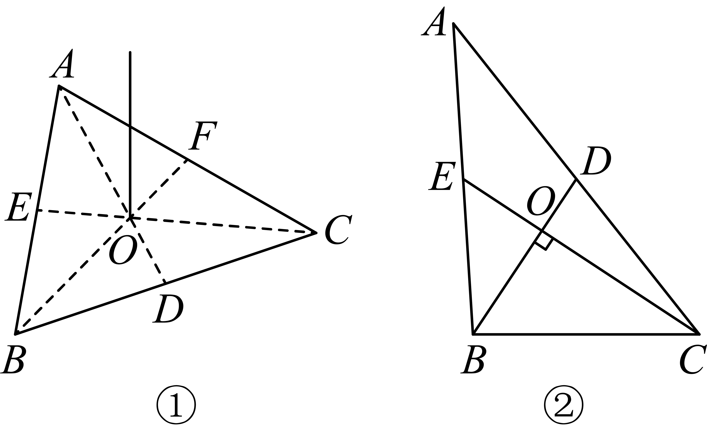

# Mathematics - 题目 2025

**ID**: c393cffc1bc9451d98160840065d7958
**年级**: Grade 8
**难度**: Medium-Hard
**题型**: Calculation

## 题目
综合与实践【探究课题】三角形重心的性质【课本重现】三角形三边中线的交点叫作这个三角形的重心．如图①，取一块质地均匀的三角形纸板 $ABC$ ，如果用一根细线绳从重心O处将三角形提起来，那么纸板就会处于水平状态．【提出问题】图①中 $\frac {AO}{DO}$ 的值是多少？【解决问题】（1）若 $\vartriangle BOC$ 的面积为m，则 $\vartriangle AOB$ 的面积为．（2）在（1）的条件下，求 $\frac {AO}{DO}$ 的值．【拓展应用】（3）如图②，在 $\vartriangle ABC$ 中，点 $O$ 是 $\vartriangle ABC$ 的重心，连接 $BO$ ， $CO$ 并延长，分别交边 $AC$ ， $AB$ 于点 $D$ ， $E$ ．若 $BO\bot CO$ ， $BD=6$ ， $CE=9$ ，直接利用上面的结论，求四边形 $AEOD$ 的面积．​​​​​​​‌

## 解答

1. 解：（1）∵点 $O$ 为 $\vartriangle ABC$ 的重心，
2. ∴ $D$ ， $E$ ， $F$ 分别是 $BC$ ， $AB$ ， $AC$ 边上的中点，
3. $\therefore S{{}_{\vartriangle ABF}}=S{{}_{\vartriangle CBF}}$ ， $S{{}_{△OAF}}=S{{}_{△OCF}}$ ，
4. $\therefore S{{}_{△AOB}}+S{{}_{△OAF}}=S{{}_{△BOC}}+S{{}_{△OCF}}$ ，
5. $\therefore S{{}_{△AOB}}=S{{}_{△BOC}}=m$ .
6. （2）由题意可知 $S{{}_{△OCD}}=S{{}_{△OBD}}=\frac {1}{2}S{{}_{△BOC}}=\frac {1}{2}m$ ， $S{{}_{△OBE}}=S{{}_{△OAE}}$ ，
7. $\because S{{}_{\vartriangle AOB}}=S{{}_{\vartriangle BOC}}=m$ ，
8. $\therefore \frac {S{{}_{△AOB}}}{S{{}_{△OBD}}}=\frac {m}{\frac {1}{2}m}=2$ ，
9. ∵ $\vartriangle AOB$ 与 $\vartriangle OBD$ 同高，
10. $\therefore \frac {S{{}_{△AOB}}}{S{{}_{△OBD}}}=\frac {AO}{DO}=2$ ，即： $\frac {AO}{DO}=2$ ；
11. （3）点 $O$ 为 $\vartriangle ABC$ 的重心，类比（1），（2）可知， $S{{}_{\vartriangle BCE}}=S{{}_{\vartriangle ACE}}$ ， $\frac {OD}{OB}=\frac {OC}{OE}=2$ ，
12. ∵ $BD=6$ ， $CE=9$ ，
13. ∴ $OD=2$ ， $OB=4$ ， $OE=3$ ， $OC=6$ ，
14. ∵ $BO\bot CO$ ，
15. ∴ $S{{}_{\vartriangle BCE}}=\frac {1}{2}CE\cdot OB=\frac {1}{2}\times 9\times 4=18$ ， $S{{}_{△COD}}=\frac {1}{2}OC\cdot OD=\frac {1}{2}\times 6\times 2=6$ ，
16. 则 $S{{}_{△BCE}}=S{{}_{△ACE}}=18$ ，
17. ∴ $S{{}_{四边形AEOD}}=S{{}_{\vartriangle ACE}}-S{{}_{\vartriangle COD}}=18-6=12$ ．

## 知识点

**中文**:
  - 三角形的中线
  - 三角形的重心

**English**:
  - Medians
  - Centroid

---
