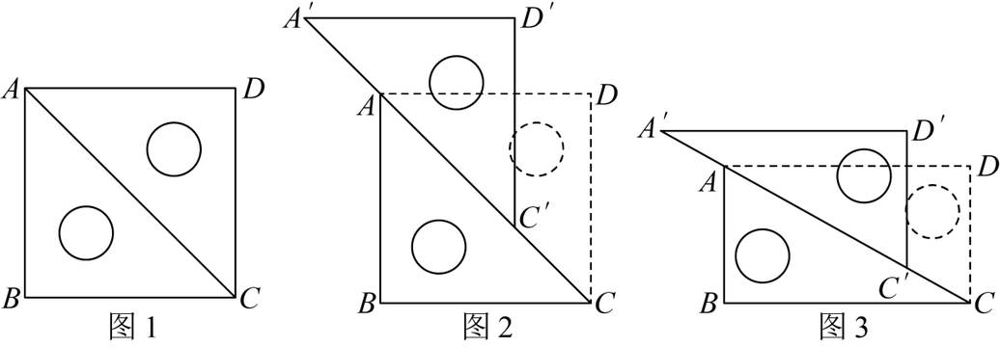

# Mathematics - 题目 1528

**ID**: c509fd7204a84ba7bdb2e9a8e466ab63
**年级**: Grade 8
**难度**: Medium-Hard
**题型**: Calculation

## 题目
综合与实践综合与实践课上，老师让同学们以“三角板的平移”为主题开展数学活动．（1）操作判断操作一：将一副等腰直角三角板两斜边重合，按图1放置；​​​​​​​‌操作二：将三角板 $ACD$ 沿 $CA$ 方向平移（两三角板始终接触）至图2位置．根据以上操作，填空：①图1中四边形 $ABCD$ 的形状是；②图2中 $AA^{′}$ 与 $CC^{′}$ 的数量关系是；四边形 $ABC^{′}D^{′}$ 的形状是．（2）迁移探究小董将一副等腰直角三角板换成一副含 $30{}\degree $ 角的直角三角板，重复上面操作，如图3．已知 $AB$ 长为 $8{\rm{c}}{\rm{m}}$ ，当平移的距离为多少时，四边形 $ABC^{′}D^{′}$ 是菱形？请写出证明过程．（3）拓展应用在（2）的探究过程中：当 $\vartriangle BCC^{′}$ 为等腰三角形时，请直接写出 $CC^{′}$ 的长．

## 解答

1. （1）（1）①解：由题意知， $\angle B=\angle BCD=\angle D=90{}\degree $ ， $AB=BC$ ，
2. ∴四边形 $ABCD$ 是正方形.
3. ②解：由平移的性质可得， $AC=A{^{\prime }}C{^{\prime }}$ ， $AB=C^{′}D^{′}$ ， $AB\parallel C^{′}D^{′}$ ，
4. ∴四边形 $ABC^{′}D^{′}$ 是平行四边形，
5. ∵ $A^{′}A+AC^{′}=AC^{′}+C^{′}C$ ，
6. ∴ $A^{′}A=C^{′}C$ .
7. （2）当平移距离是 $8{\rm{c}}{\rm{m}}$ 时，四边形 $ABC^{′}D^{′}$ 是菱形．
8. 理由如下：如图所示，连接 $AD^{′}$ ， $BC^{′}$ ，连接 $BD^{′}$ 交 $AC^{′}$ 于点 $O$
9. $\because AB=8{\rm{c}}{\rm{m}}$ ， $\angle ACB=30{}\degree $ ， $\angle ABC=90{}\degree $ ，
10. $\therefore AC=16{\rm{c}}{\rm{m}}$ ， $\angle BAC=60{}\degree $ ，
11. $\because $ 将三角板 $ACD$ 沿 $CA$ 方向平移，
12. $\therefore CD=C^{′}D^{′}=AB$ ， $CD\mathrm{/\mskip-4mu/}{C^{′}D^{′}}\mathrm{/\mskip-4mu/}AB$ ，
13. $\therefore $ 四边形 $ABC^{′}D^{′}$ 是平行四边形．
14. 当平移的距离为 $8{\rm{c}}{\rm{m}}$ 时，即 $CC^{′}=AA^{′}=8{\rm{c}}{\rm{m}}$ ，
15. $\therefore AC^{′}=AC-CC^{′}=8{\rm{c}}{\rm{m}}$ ，
16. $\therefore AB=AC^{′}$ ，
17. $\because AB=AC^{′}$ ， $\angle BAC=60{}\degree $ ，
18. $\therefore △ABC^{′}$ 是等边三角形，
19. $\therefore AB=BC^{′}$ ，
20. $\therefore $ 四边形 $ABC^{′}D^{′}$ 是菱形．
21. $\therefore $ 当平移距离是 $8{\rm{c}}{\rm{m}}$ 时，四边形 $ABC^{′}D^{′}$ 是菱形．
22. （3） $8{\rm{c}}{\rm{m}}$ 或 $8\sqrt {3}{\rm{c}}{\rm{m}}$ ．
23. $\because \vartriangle ABC$ 是含 $30{}\degree $ 角的直角三角板，即 $\angle ACB=30{}\degree $ ， $AB$ 边长为 $8{\rm{c}}{\rm{m}}$ ，
24. $\therefore AC=2AB=2\times 8=16$ ，
25. ①当 $BC^{′}=CC^{′}$ 时， $\vartriangle BCC^{′}$ 为等腰三角形，如图所示，
26. 
27. $\because \angle ACB=30{}\degree $ ， $BC^{′}=CC^{′}$ ，
28. $\therefore \angle CBC^{′}=\angle BCC^{′}=30{}\degree $ ，
29. $\therefore \angle ABC^{′}=\angle ABC-\angle CBC^{′}=90{}\degree -30{}\degree =60{}\degree $ ，且 $\angle BAC^{′}=60{}\degree $ ，
30. $\therefore BC^{′}=AC^{′}$ ，
31. $\therefore $ 点 $C^{′}$ 是 $AC$ 的中点，
32. $\therefore CC^{′}=\frac {1}{2}AC=8{\rm{c}}{\rm{m}}$ ；
33. ②当 $BC=C^{′}C$ 时， $\vartriangle BCC^{′}$ 为等腰三角形，如图所示，
34. 
35. $\because \angle ACB=30{}\degree $ ， $AB=8{\rm{c}}{\rm{m}}$ ， $\angle ABC=90{}\degree $ ，
36. $\therefore $ 在 ${\rm{R}}{\rm{t}}\mathrm{△}ABC$ 中，由勾股定理得， $BC=8\sqrt {3}$ ，
37. $\because △BCC^{′}$ 为等腰三角形， $BC=C^{′}C$ ，
38. $\therefore CC^{′}=BC=8\sqrt {3}$ ；
39. ③当 $BC=BC^{′}$ 时， $\vartriangle BCC^{′}$ 为等腰三角形，如图所示，
40. 
41. 与“将三角板 $ACD$ 沿 $CA$ 方向平移（两三角板始终接触）”矛盾，
42. $\therefore $ 不存在；
43. 综上所示，当 $\vartriangle BCC^{′}$ 为等腰三角形时， $CC^{′}$ 的长为 $8{\rm{c}}{\rm{m}}$ 或 $8\sqrt {3}{\rm{c}}{\rm{m}}$ ．

## 知识点

**中文**:
  - 几何变换——平移综合题
  - 菱形的判定
  - 正方形的判定
  - 四边形综合

**English**:
  - Translation Comprehensive Problems
  - Determination of Rhombuses
  - Determination of Squares
  - Comprehensive Quadrilateral Problems

---
