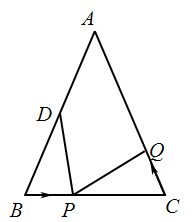

# Mathematics - 题目 2800

**ID**: c83774218b9c4cb68bb2aa757ff0e2a9
**年级**: Grade 8
**难度**: Medium-Hard
**题型**: Calculation

## 题目
已知：如图，在 $\vartriangle ABC$ 中， $AB=AC=12$ ， $BC=9$ ，点 $D$ 为AB的中点．（1）如果点 $P$ 在线段 $BC$ 上以每秒 $3$ 个单位的速度由 $B$ 点向 $C$ 点运动，同时，点 $Q$ 在线段 $CA$ 上由 $C$ 点向 $A$ 点运动，运动的时间 $t$ 秒．①若点 $Q$ 的运动速度与点 $P$ 的运动速度相等， $t=1$ 时， $\mathrm{△}BPD$ 与 $\vartriangle CQP$ 是否全等？请说明理由；​​​​​​​‌②若点 $Q$ 的运动速度与点 $P$ 的运动速度不相等，当 $\mathrm{△}BPD$ 与 $\vartriangle CQP$ 全等时，求点 $Q$ 的运动速度．（2）若点 $Q$ 以（1）②中的运动速度从点 $C$ 出发，点 $P$ 以原来的运动速度从点 $B$ 同时出发，都逆时针沿 $\vartriangle ABC$ 三边运动，则经过多长时间，点 $P$ 与点 $Q$ 第一次在 $\vartriangle ABC$ 的哪条边上相遇？此时相遇点距离 $B$ 点的路程是多少？

## 解答

1. 解：（1）①∵t=1（秒），
2. ∴BP=CQ=3（厘米），
3. ∵AB=12，D为AB中点，
4. ∴BD=6（厘米），
5. 又∵PC=BC-BP=9-3=6（厘米），
6. ∴PC=BD，
7. ∵AB=AC，
8. ∴∠B=∠C，
9. 在△BPD与△CQP中，
10. $\begin{cases}BP=CQ\\\angle B=\angle C\\BD=PC\end{cases}$ ，
11. ∴△BPD≌△CQP（SAS）；
12. ②∵VP≠VQ，
13. ∴BP≠CQ，
14. 又∵∠B=∠C，
15. 要使△BPD≌△CPQ，只能BP=CP=4.5，
16. ∵△BPD≌△CPQ，
17. ∴CQ=BD=6．
18. ∴点P的运动时间t= $\frac {BP}{3}$ = $\frac {4.5}{3}$ =1.5（秒），
19. 此时VQ= $\frac {CQ}{t}$ = $\frac {6}{1.5}$ =4（厘米/秒）；
20. 答：点Q的运动速度是4厘米/秒；
21. （2）因为VQ＞VP，只能是点Q追上点P，即点Q比点P多走AB+AC的路程，
22. 设经过x秒后P与Q第一次相遇，依题意得4x=3x+2×12，
23. 解得x=24（秒），
24. 此时P运动了24×3=72（厘米），
25. 又∵△ABC的周长为33厘米，72=33×2+6，
26. ∴点P、Q在BC边上相遇，即经过了24秒，点P与点Q第一次在BC边上相遇，此时相遇点距离B点的路程是6厘米．

## 知识点

**中文**:
  - 等腰三角形的性质

**English**:
  - Properties of Isosceles Triangles

---
