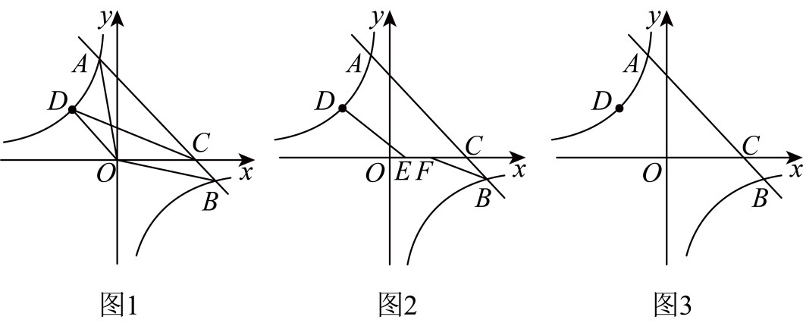

# Mathematics - 题目 2204

**ID**: ceffba9e8ab44ad8bfc1d6b5a4b0a3f4
**年级**: Grade 8
**难度**: Medium-Hard
**题型**: Calculation

## 题目
如图1，在平面直角坐标系中，一次函数 $y{{}_{1}}=ax+b$ 与反比例函数 $y{{}_{2}}=\frac {k}{x}$ 交于点A和点B，点A的坐标为 $\left ({-1,5}\right )$ ，点B的横坐标为5，一次函数与x轴交于点C．（1）求a，b，k的值；​​​​​​​‌（2）如图1，点D是第二象限内反比例函数上一动点，连接 $OD{\rm{，}}CD$ ．当 $S{{}_{\mathrm{△}OCD}}=\frac {1}{2}S{{}_{\mathrm{△}OAB}}$ 时，求点D的坐标；（3）如图2，在（2）问的条件下，点E，F均为x轴上的动点，且点E在点F的左侧， $EF=1$ ．求 $DE+EF+FB$ 的最小值；（4）如图3，点G是x轴上一点，点H是平面内一点，在（2）问的条件下，是否存在以点G，C，D，H为顶点的四边形是菱形，若存在，直接写出点H的坐标；若不存在，请说明理由．

## 解答

1. （1）解： $\because $ 一次函数 $y{{}_{1}}=ax+b$ 与反比例函数 $y{{}_{2}}=\frac {k}{x}$ 交于点A和点B，点A的坐标为 $\left ({-1,5}\right )$ ，
2. $\therefore k=-1\times 5=-5$ ，即 $y{{}_{2}}=-\frac {5}{x}$ ，
3. $\because $ 点B的横坐标为5，
4. $\therefore y=-\frac {5}{5}=-1$ ，即点B的坐标为 $\left ({5,-1}\right )$ ，
5. $\therefore $  $\begin{cases}5a+b=-1\\-a+b=5\end{cases}$ ，
6. 解得 $\begin{cases}\begin{matrix}a=-1\\b=4\end{matrix}\end{cases}$ ，
7. 综上， $a=-1$ ， $b=4$ ， $k=-5$ ；
8. （2）解：由（1）知，一次函数为 $y{{}_{1}}=-x+4$ ，
9. 当 $y{{}_{1}}=0$ 时， $-x+4=0$ ，解得 $x=4$ ，
10. $\therefore $ 点C的坐标为 $\left ({4,0}\right )$ ，即 $OC=4$ ，
11. $\because $ 点A的坐标为 $\left ({-1，5}\right )$ ，点B的坐标为 $\left ({5,-1}\right )$ ，
12. $\therefore $  $S{{}_{\vartriangle OAB}}=\frac {1}{2}\times 4\times \left [5-\left ({-1}\right )\right ]=12$ ，
13. $\because $ 点D是第二象限内反比例函数上一动点，
14. 设点D的坐标为 $\left ({d,-\frac {5}{d}}\right )\left ({d<0}\right )$ ，
15. $\because $  $S{{}_{\mathrm{△}OCD}}=\frac {1}{2}S{{}_{\mathrm{△}OAB}}$ ，
16. $\therefore \frac {1}{2}\times 4\times \left ({-\frac {5}{d}}\right )=6$ ，
17. 解得 $d=-\frac {5}{3}$ ，
18. $\therefore $ 点D的坐标为 $\left ({-\frac {5}{3},3}\right )$ ；
19. （3）解：将点 ${\rm \mathit{D}}\left ({-\frac {5}{3},3}\right )$ 向右平移一个单位，得到 $D^{′}$  $\left ({-\frac {2}{3},3}\right )$ ，连接 $D{^{\prime }}F$ ， $D^{′}B$ ，
20. 
21. $\because $  $EF=1$ ，
22. $\therefore DD^{′}=1=EF$ ，且 $DD^{′}{{\rm{/\mskip-4mu/}}}EF$ ，
23. $\therefore $ 四边形 $DEFD^{′}$ 为平行四边形，
24. $\therefore DE=D^{′}F$ ，
25. $\therefore $  $DE+EF+FB=D^{′}F+FB+EF$ ，
26. $\because $  $EF=1$ 为定长，要 $DE+EF+FB=D^{′}F+FB+EF$ 的值最小，即 $D^{′}F+FB$ 的值最小，
27. 当 $D^{′},F,B$ 三点共线时， $D^{′}F+FB$ 的最小值为 $D^{′}B=\sqrt {{\left({5+\frac {2}{3}}\right)^{2}}+{\left({-1-3}\right)^{2}}}=\frac {\sqrt {433}}{3}$ ，
28. $\therefore $  $DE+EF+FB$ 的最小值为 $1+\frac {\sqrt {433}}{3}$ ；
29. （4）解：存在以点G，C，D，H为顶点的四边形是菱形，
30. $\because $ 点D的坐标为 $\left ({-\frac {5}{3},3}\right )$ ，点C的坐标为 $\left ({4,0}\right )$ ，
31. $\therefore CD=\sqrt {{\left({4+\frac {5}{3}}\right)^{2}}+{\left({0-3}\right)^{2}}}=\frac {\sqrt {370}}{3}$ ，
32. ①当 $CG,CD$ 为边时；
33. $\because $ 以点G，C，D，H为顶点的四边形是菱形，
34. $\therefore $  $CG=CD=DH=HG=\frac {\sqrt {370}}{3}$ ， $DH{\rm{/\mskip-4mu/}}CG$ ，
35. $\therefore $  $H\left ({\frac {-5+\sqrt {370}}{3},3}\right )$ 或 $H\left ({\frac {-5-\sqrt {370}}{3},3}\right )$ ，
36. ②当 $CD$ 为边， $CG$ 为对角线时；连接 $DH$ 交 $CG$ 于点 $Q$ ，
37. 
38. $\because $ 以点G，C，D，H为顶点的四边形是菱形，
39. $\therefore DH\bot CG,HQ=DQ=3$ ，
40. $\therefore $  $H\left ({-\frac {5}{3},-3}\right )$ ；
41. ③当 $CG$ 为边， $CD$ 为对角线时；
42. 
43. $\because $ 以点G，C，D，H为顶点的四边形是菱形，
44. $\therefore CG=DG$ ，
45. 设 $G\left ({m,0}\right )$ ，
46. $\therefore DG{^{2}}={\left({m+\frac {5}{3}}\right)^{2}}+{\left({0-3}\right)^{2}}$ ， $CG{^{2}}={\left({4-m}\right)^{2}}$ ，
47. $\therefore $  ${\left({m+\frac {5}{3}}\right)^{2}}+{\left({0-3}\right)^{2}}={\left({4-m}\right)^{2}}$ ，解得 $m=\frac {19}{51}$ ，
48. $\therefore DH=CG=4-\frac {19}{51}=\frac {185}{51}$ ，
49. $\therefore $  $H\left ({\frac {100}{51},3}\right )$ ；
50. 综上所述， $H\left ({-\frac {5}{3},-3}\right )$ 或 $H\left ({\frac {100}{51},3}\right )$ 或 $H\left ({\frac {-5+\sqrt {370}}{3},3}\right )$ 或 $H\left ({\frac {-5-\sqrt {370}}{3},3}\right )$ ．

## 知识点

**中文**:
  - 反比例函数的性质
  - 菱形的性质
  - 待定系数法求一次函数解析式

**English**:
  - Properties of Inverse Proportionality Functions
  - Properties of Rhombuses
  - Finding Expressions by Undetermined Coefficients

---
