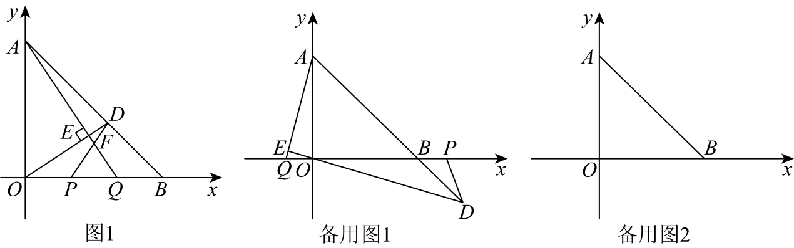

# Mathematics - 题目 2841

**ID**: d097aaa04d5d42abbb1d1a641286456f
**年级**: Grade 8
**难度**: Medium-Hard
**题型**: Calculation

## 题目
【问题情境】如图，在平面直角坐标系中，点 $A\left ({0,m}\right ),B\left ({n,0}\right )$ ，且 ${\left({m-n}\right)^{2}}+n{^{2}}-4n+4=0$ ，连接 $AB$ ， $\angle OAB=45{}\degree $ ，点P，点Q是x轴上的动点，且 $OP=BQ$ ．连接 $AQ$ ，过O点作 $OD\bot AQ$ 于点E，交直线 $AB$ 于点D，连接 $DP$ ，试问在运动过程中， $\angle BPD$ 与 $\angle AQO$ 是否存在某种特定的数量关系．(1)直接写出点A的坐标为，点B的坐标为；​​​​​​​‌(2)【深入探究】如图1，当点P，点Q在线段 $OB$ 上，且P点在Q点的左侧时．①求证： $\angle DOB=\angle QAO$ ；②试猜想 $\angle BPD$ 与 $\angle AQO$ 的数量关系，并说明理由．(3)【拓展应用】当点P在B点右侧，点Q在x轴负半轴上运动时，若 $\angle AQO=α$ ，用 $α$ 表示 $\angle BPD=$（不需证明）

## 解答

1. （1）解：已知 ${\left({m-n}\right)^{2}}+n{^{2}}-4n+4=0$ ，
2. ∴ ${\left({m-n}\right)^{2}}+{\left({n-2}\right)^{2}}=0$ ，
3. ∵ ${\left({m-n}\right)^{2}}\geqslant 0,{\left({n-2}\right)^{2}}\geqslant 0$ ，
4. ∴ $n=2,m=n=2$ ，
5. ∴ $A\left ({0,2}\right ),B\left ({2,0}\right )$ ，
6. （2）解：①∵ $\angle AOB=90{}\degree $ ，
7. ∴ $\angle AOE+\angle DOB=90{}\degree $ ，
8. ∵ $OD\bot AQ$ ，
9. ∴ $\angle QAO+\angle AOE=90{}\degree $ ，
10. ∴ $\angle DOB=\angle QAO$ ；
11. ② $\angle BPD=\angle AQO$ ，理由如下，
12. 如图所示，过点 $B$ 作 $OB$ 的垂线交 $OD$ 延长线于点 $M$ ，
13. 
14. ∴ $\angle MBO=90{}\degree =\angle AOQ$ ，
15. ∵ $A\left ({0,2}\right ),B\left ({2,0}\right )$ ，
16. ∴ $OA=OB,\angle OAB=\angle OBA=45{}\degree $ ，
17. ∵ $\angle MOB=\angle QAO$ ，
18. ∴ $\mathrm{△}AOQ≌\mathrm{△}OBM\left ({\mathrm{A}\mathrm{S}\mathrm{A}}\right )$ ，
19. ∴ $BM=OQ$ ， $\angle AQO=\angle M$ ，
20. ∵ $OP=BQ$ ，
21. ∴ $OP+PQ=PQ+BQ$ ，即 $OQ=BP$ ，
22. ∴ $BM=BP$ ，
23. ∵ $\angle OBM=90{}\degree ,\angle ABO=45{}\degree $ ，
24. ∴ $\angle MBD=\angle PBD=45{}\degree $ ，且 $BD=BD$ ，
25. ∴ $\mathrm{△}PBD≌\mathrm{△}MBD\left ({\mathrm{S}\mathrm{A}\mathrm{S}}\right )$ ，
26. ∴ $\angle M=\angle BPD$ ，
27. ∴ $\angle BPD=\angle AQO$ ；
28. （3）解： $α$ 或 $\left ({180{}\degree -α}\right )$ ，理由如下，
29. 第一种情况，如图所示，过点 $B$ 作 $OB$ 的垂线交 $OD$ 于点 $N$ ，
30. 
31. ∵ $AO=OB,\angle AOQ=\angle OBN=90{}\degree $ ，
32. ∴ $\angle QOE=90{}\degree -\angle AOE=\angle OAQ$ ，
33. ∵ $\angle BON=\angle EOQ$ ，
34. ∴ $\angle BON=\angle OAQ$ ，
35. ∴ $\mathrm{△}AOQ≌\mathrm{△}OBN\left ({\mathrm{A}\mathrm{S}\mathrm{A}}\right )$ ，
36. ∴ $\angle AQO=\angle ONB=α$ ， $OQ=BN$ ，
37. ∴ $\angle BND=180{}\degree -\angle ONB=180{}\degree -α$ ，
38. ∵ $OP=BQ$ ，
39. ∴ $OP-OB=BQ-OB$ ，即 $ON=BP$ ，
40. ∴ $BN=BP$ ，
41. ∵ $\angle ABO=\angle PBD=45{}\degree ，\angle NBP=90{}\degree $ ，
42. ∴ $\angle NBD=\angle PBD=45{}\degree $ ，且 $BD=BD$ ，
43. ∴ $\mathrm{△}BND≌\mathrm{△}BPD\left ({\mathrm{S}\mathrm{A}\mathrm{S}}\right )$ ，
44. ∴ $\angle BPD=\angle BND$ ，
45. ∴ $\angle BPD=180{}\degree -α$ ；
46. 第二种情况，如图所示，过点 $B$ 作 $OB$ 的垂线交 $DO$ 延长线于点 $N$ ，
47. 
48. 同理可证， $\mathrm{△}BOM≌\mathrm{△}AOQ$ ，得到 $\angle AQO=\angle N=α$ ，
49. 同理可证， $\mathrm{△}BDP≌\mathrm{△}BDN$ ，得到 $\angle N=\angle BPD=α$ ；
50. 综上所述， $\angle BPD=α$ 或 $\angle BPD=180{}\degree -α$ .

## 知识点

**中文**:
  - 余角和补角
  - 坐标与图形性质
  - 全等三角形的判定与性质

**English**:
  - Complementary and Supplementary Angles
  - Coordinates and Geometric Properties
  - Determination and Properties

---
