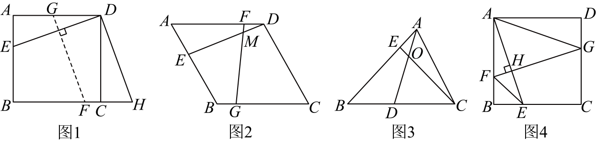

# Mathematics - 题目 2327

**ID**: d33337f3d01441cbb13535b83fe5089d
**年级**: Grade 8
**难度**: Medium-Hard
**题型**: Calculation

## 题目
综合与探究问题情境：如图1，在正方形 $ABCD$ 中， $E$ ， $F$ ， $G$ 分别是 $AB$ ， $BC$ ， $AD$ 边上的点，连接 $DE$ ， $GF$ ．若 $DE\bot GF$ ，判断 $DE$ 与 $GF$ 之间的数量关系．老师在课堂上给出如下分析：将 $GF$ 沿 $AD$ 方向平移到 $DH$ ，连接 $CH$ ．根据平移的性质，可判断四边形 $DGFH$ 是平行四边形，再证明 $△ADE≌△CDH$ ，得到 $DE=DH$ ，继而得到 $DE=GF$ ．尝试初探：（1）老师提出该问题的变式问题：将正方形 $ABCD$ 改为菱形 $ABCD$ ， $\angle A=60{}\degree $ ，如图 ${\rm 2，}E$ ， $F$ ， $G$ 分别是 $AB$ ， $AD$ ， $BC$ 边上的点，连接 $FG$ 与 $DE$ 交于点 $M$ ．若 $\angle EMG=60{}\degree $ ，猜想 $DE$ 与 $FG$ 之间的数量关系，并说明理由，通过探究发现，可以利用平移这一手段，将有些条件集中在一起来解决问题．迁移应用：（2）如图3，在 $\vartriangle ABC$ 中，点 $D$ ， $E$ 分别在 $BC$ ， $AB$ 边上，且 $AD=CE$ ， $AD$ ， $CE$ 交于点 $O$ ， $∠AOE=60{}\degree $ ．判断 $AE+CD$ 与 $AD$ 的大小关系，并说明理由．拓展探究：（3）如图4，在正方形 $ABCD$ 中，点 $E$ ， $F$ 分别在 $BC$ ， $AB$ 边上，过点 $F$ 作 $FG\bot AE$ 于点 $H$ ，交 $CD$ 边于点 $G$ ，连接 $EF$ ， $AG$ ．若 $AB=6$ ， $CE=2BE$ ，请直接写出 $AG+EF$ 的最小值．​​​​​​​‌

## 解答

1. 解：（1） $DE=FG$ ，理由如下：
2. 
3. 如图，沿 $AD$ 平移线段 $FG$ ，使点 $F$ 与点 $D$ 重合，点 $G$ 与点 $G^{′}$ 重合，连接 $BD$
4. 根据平移的性质可得 $DG^{′}=FG$ ， $FG\mathrm{/\mskip-4mu/}DG^{′}$ ，
5. $\therefore \angle EDG^{′}=\angle EMG=60{}\degree $ ，
6. ∵四边形 $ABCD$ 为菱形，且 $\angle A=60{}\degree $ ，
7. $\therefore \angle C=\angle A=60{}\degree $ ，
8. $\therefore \vartriangle ABD$ 与 $\mathrm{△}BCD$ 都是等边三角形，
9. $\therefore \angle A=\angle DBG^{′}=60{}\degree $ ， $\angle ADB=60{}\degree $ ， $AD=DB$
10. $\therefore \angle ADE+\angle BDE=\angle BDG^{′}+\angle BDE=60{}\degree $ ，
11. $\therefore \angle ADE=\angle BDG^{′}$ ，
12. 在 $\vartriangle ADE$ 与 $\vartriangle BDG^{′}$ 中，
13. $\begin{cases}\angle A=\angle DBG^{′}\\AD=DB\\\angle ADE=\angle BDG^{′}\end{cases}$
14. ∴ $\vartriangle ABD≌\vartriangle BDG^{′}{\left ({{\rm{A}}{\rm{S}}{\rm{A}}}\right )}$ ，
15. $\therefore DE=DG^{′}$
16. ∴ $DE=FG$ ；
17. （2） $AE+CD>AD$ ，理由如下：
18. 
19. 如图，沿 $AB$ 平移线段 $AD$ ，使点 $\mathrm{A}$ 与点 $E$ 重合，点 $D$ 与点 $D^{′}$ 重合，连接 $DD^{′},CD^{′}$ ，
20. 根据平移的性质可得， $ED^{′}=AD，ED^{′}{\mathrm{/\mskip-4mu/}}AD,AE=DD^{′}$ ，
21. $\therefore \angle CED^{′}=\angle AOE=60{}\degree $ ，
22. 又 $AD=CE$ ，即 $ED^{′}=CE$ ，
23. $\therefore △ECD^{′}$ 为等边三角形，
24. $\therefore ED^{′}=CE=CD^{′}$ ，
25. 在 $\mathrm{△}CDD^{′}$ 中， $DD^{′}+CD\mathrm{>}CD^{′}$
26. ∴ $AE+CD>AD$ ；
27. （3）
28. 
29. 如图，沿 $AG$ 平移线段 $AE$ ，使点 $\mathrm{A}$ 与点 $G$ 重合，点 $E$ 与点 $E^{′}$ 重合，连接 $FE^{′}，EE^{′}$ ，
30. 根据平移的性质可得， $GE^{′}=AE,GE^{′}{\mathrm{/\mskip-4mu/}}AE,EE^{′}=AG$ ，
31. 又∵ $FG\bot AE$ ，
32. ∴ $\angle AHG=90{}\degree $
33. ∴ $\angle FGE^{′}=90{}\degree $ ,
34. ∵四边形 $ABCD$ 为正方形， $AB=6$ ， $CE=2BE$ ，
35. $\therefore BE=\frac {1}{3}BC=2$ ，
36. 在 ${\rm{R}}{\rm{t}}△ABE$ 中，由勾股定理得 $AE=\sqrt {AB{^{2}}+BE{^{2}}}=2\sqrt {10}$ ,
37. 由图1结论可得 $FG=AE$ ，
38. ∴ $FG=AE=GE^{′}=2\sqrt {10}$ ，
39. ∵ $AG+EF=EE^{′}+EF$
40. ∴当点 $F,E,E^{′}$ 共线时， $EE^{′}+EF$ 最小，即 $AG+EF$ 最小，最小值为 $E^{′}F$ 的长度，
41. ∴在 ${\rm{R}}{\rm{t}}\vartriangle FGE^{′}$ 中，由勾股定理得 $E^{′}F=\sqrt {FG{^{2}}+GE^{′}{{^{2}}}}=4\sqrt {5}$ ，
42. 即 $AG+EF$ 的最小值为 $4\sqrt {5}$ ．

## 知识点

**中文**:
  - 几何变换——平移综合题
  - 菱形的性质
  - 正方形的性质

**English**:
  - Translation Comprehensive Problems
  - Properties of Rhombuses
  - Properties of Squares

---
