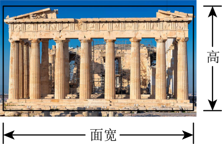
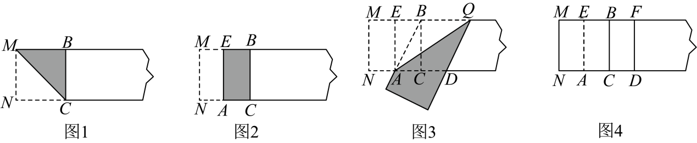

# Mathematics - 题目 1622

**ID**: e0a76d998e31460ead25454bc9ea53c7
**年级**: Grade 8
**难度**: Medium-Hard
**题型**: Calculation

## 题目
背景知识：宽与长的比等于 $\frac {\sqrt {5}-1}{2}$ （约为0.​​​​​​​‌618）的矩形称为黄金矩形．黄金矩形给我们以协调、匀称的美感．世界上很多著名建筑，为了取得最佳的视觉效果，都采用了黄金矩形的设计，如希腊帕特农神庙等．（1）如图，经测量，帕特农神庙的面宽约为31米，那么它的高度大约是米．（结果取整数）实验操作：折一个黄金矩形第一步，在矩形纸片的一端利用图1的方法折出一个正方形 $MNCB$ ，然后把纸片展平；第二步：如图2，将正方形折成两个相等的矩形，再将其展平；第三步：折出内侧矩形的对角线 $AB$ ，并将 $AB$ 折到图3所示的 $AD$ 处；第四步，展平纸片，按照所得的点 $D$ 折出 $DF$ ，矩形 $BCDF$ 就是黄金矩形（如图4）．问题思考：（2）图4中是否还存在其它黄金矩形，请判断并说明理由；（3）以图3中的折痕 $AQ$ 为边，构造黄金矩形，若 $MN=2$ ，则这个矩形的面积是（直接写出结果）．

## 解答

1. 解：（1）由题意，得：帕特农神庙的高度与面宽的比约为 $0.618$ ，
2. ∴帕特农神庙的高度 $\approx 31\times 0.618\approx 19$ ；
3. （2）存在，理由如下：
4. 设 $MN=2a$ ，则： $BC=MB=MN=2a$ ，
5. 由折叠可知
6. $ME=BE=a$ ，
7. ∵矩形 $BCDF$ 就是黄金矩形，
8. ∴ $\frac {BF}{BC}=\frac {\sqrt {5}-1}{2}$ ，
9. ∴ $BF=\left ({\sqrt {5}-1}\right )a$ ，
10. ∴ $MF=MB+BF=\left ({\sqrt {5}+1}\right )a$ ，
11. ∴ $\frac {MN}{MF}=\frac {2a}{\left ({\sqrt {5}+1}\right )a}=\frac {\sqrt {5}-1}{2}$ ，
12. ∴矩形 $MNDF$ 为黄金矩形；
13. （3）∵ $MN=2$ ，则： $MB=MN=AE=2$ ，
14. ∴ $BE=\frac {1}{2}MB=1$ ，
15. ∴ $AB=\sqrt {AE{^{2}}+BE{^{2}}}=\sqrt {5}$ ，
16. ∵折叠，
17. ∴ $\angle BAQ=\angle QAD$ ，
18. ∵矩形纸片，
19. ∴ $MQ\mathrm{/\mskip-4mu/}DN$ ，
20. ∴ $\angle BQA=\angle QAD=\angle BAQ$ ，
21. ∴ $BQ=AB=\sqrt {5}$ ，
22. ∴ $EQ=BE+BQ=\sqrt {5}+1$ ，
23. ∴ $AQ=\sqrt {EQ{^{2}}+AE{^{2}}}=\sqrt {10+2\sqrt {5}}$ ，
24. 当 $AQ$ 为黄金矩形的长时，则宽为 $\frac {\sqrt {5}-1}{2}AQ$ ，
25. 则矩形的面积为： $\frac {\sqrt {5}-1}{2}AQ{^{2}}=\frac {\sqrt {5}-1}{2}\times \left ({10+2\sqrt {5}}\right )=4\sqrt {5}$ ；
26. 当 $AQ$ 为黄金矩形的宽时，则长为 $\frac {2}{\sqrt {5}-1}AQ=\frac {\sqrt {5}+1}{2}AQ$ ，
27. 则矩形的面积为： $\frac {\sqrt {5}+1}{2}AQ{^{2}}=\frac {\sqrt {5}+1}{2}\times \left ({10+2\sqrt {5}}\right )=6\sqrt {5}+10$ ；
28. 综上：矩形的面积为 $10+6\sqrt {5}$ 或 $4\sqrt {5}$ ．

## 知识点

**中文**:
  - 二次根式的混合运算
  - 矩形的性质
  - 折叠问题

**English**:
  - Mixed Operations of Secondary Radicals
  - Properties of Rectangles
  - Folding Problems

---
