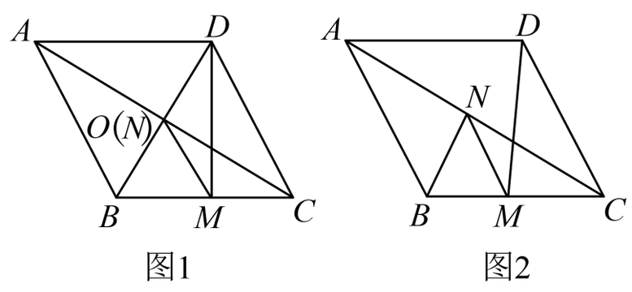

# Mathematics - 题目 1044

**ID**: e0ca4b9e79e54390a6f0cbb22ee3eb8a
**年级**: Grade 8
**难度**: Medium-Hard
**题型**: Calculation

## 题目
如图，在菱形 $ABCD$ 中， $\angle BCD=60{}\degree $ ，点 $M$ 在 $BC$ 上，点 $N$ 在 $AC$ 上，且 $MN=BN$ ．（1）如图1，若 $AC$ ， $BD$ 相交于点 $O$ ，点 $N$ 恰好与点 $O$ 重合，求 $\angle DMN$ 的度数；​​​​​​​‌（2）如图2，当点 $N$ 在 $AC$ 上运动时， $\angle DMN$ 的度数会发生变化吗？请说明理由．

## 解答

1. （1）解：当点N恰好与点O重合时，如图1所示：
2. 
3. ∵四边形 $ABCD$ 是菱形，
4. ∴ $BC=CD$ ， $OB=OD$ ，
5. ∵ $\angle BCD=60{}\degree $ ，
6. ∴ $\mathrm{△}BCD$ 是等边三角形，
7. ∴ $\angle CBD=60{}\degree $ ，
8. ∵ $MN=BN$ ，
9. ∴ $\mathrm{△}BMN$ 是等边三角形，
10. ∴ $\angle BNM=60{}\degree $ ，
11. ∴ $\angle DNM=180{}\degree -\angle BNM=120{}\degree $ ，
12. 又∵ $MN=BN$ ， $BN=DN$ ，
13. ∴ $DN=MN$ ，
14. ∴ $\angle DMN=\frac {1}{2}\left ({180{}\degree -\angle DNM}\right )=\frac {1}{2}\left ({180{}\degree -120{}\degree }\right )=30{}\degree $ ；
15. （2）解：当点N在 $AC$ 上运动时， $\angle DMN$ 的度数不发生变化，始终等于 $30{}\degree $ ，理由如下：
16. 连接 $BD$ 交 $AC$ 于点O，连接 $DN$ ，
17. ∵四边形 $ABCD$ 是菱形，
18. ∴ $AC$ 是 $BD$ 的垂直平分线，
19. ∴ $BN=DN$ ，
20. ∴设 $\angle NBO=\angle NDO=α$ ，
21. 由（1）可知， $\mathrm{△}BCD$ 是等腰三角形， $\angle DBC=60{}\degree $ ，
22. 依题意有以下两种情况：
23. ①当点N在线段 $OA$ 上时，如图2①所示：
24. 
25. ∴ $\angle NBM=\angle DBC+\angle NBO=60{}\degree +α$ ，
26. ∵ $MN=BN$ ，
27. ∴ $\angle NMB=\angle NBM=60{}\degree +α$ ，
28. 在 $\mathrm{△}NBM$ 中， $\angle BNM+\angle NMB+\angle NBM=180{}\degree $ ，
29. ∴ $\angle BNM+60{}\degree +α+60{}\degree +α=180{}\degree $ ，
30. ∴ $\angle BNM=60{}\degree -2α$ ，
31. ∵ $AC\bot BD$ ， $\angle NBO=\angle NDO=α$ ，
32. ∴ $\angle BNO=\angle DNO=90{}\degree -α$ ，
33. ∴ $\angle MNO=\angle BNO-\angle BNM=90{}\degree -α-\left ({60{}\degree -2α}\right )=30{}\degree +α$ ，
34. ∴ $\angle MND=\angle MNO+\angle DNO=30{}\degree +α+90{}\degree -α=120{}\degree $ ，
35. ∵ $BN=DN$ ， $MN=BN$ ，
36. ∴ $MN=DN$ ，
37. ∴ $\angle DMN=\frac {1}{2}\left ({180{}\degree -\angle MND}\right )=\frac {1}{2}\times \left ({180{}\degree -120{}\degree }\right )=30{}\degree $ ；
38. ②当点N在线段OC上时，如图2②所示：
39. 
40. ∴ $\angle NBM=\angle DBC-\angle NBO=60{}\degree -α$ ，
41. ∵ $MN=BN$ ，
42. ∴ $\angle NMB=\angle NBM=60{}\degree -α$ ，
43. 在 $\mathrm{△}NBM$ 中， $\angle BNM+\angle NMB+\angle NBM=180{}\degree $ ，
44. ∴ $\angle BNM+60{}\degree -α+60{}\degree -α=180{}\degree $ ，
45. ∴ $\angle BNM=60{}\degree +2α$ ，
46. ∵ $AC\bot BD$ ， $\angle NBO=\angle NDO=α$ ，
47. ∴ $\angle BNO=\angle DNO=90{}\degree -α$ ，
48. ∴ $\angle MNC=180{}\degree -\left ({\angle BNO+\angle BNM}\right )=180{}\degree -\left ({90{}\degree -α+60{}\degree +2α}\right )=30{}\degree -α$ ，
49. ∵ $\angle CND=180{}\degree -\angle DNO=180{}\degree -\left ({90{}\degree -α}\right )=90{}\degree +α$ ，
50. ∴ $\angle MND=\angle MNC+\angle CND=30{}\degree -α+90{}\degree +α=120{}\degree $ ，
51. ∵ $BN=DN$ ， $MN=BN$ ，
52. ∴ $MN=DN$ ，
53. ∴ $\angle DMN=\frac {1}{2}\left ({180{}\degree -\angle MND}\right )=\frac {1}{2}\times \left ({180{}\degree -120{}\degree }\right )=30{}\degree $ ，
54. 综上所述：当点N在 $AC$ 上运动时， $\angle DMN$ 的度数不发生变化，始终等于 $30{}\degree $ ．

## 知识点

**中文**:
  - 线段垂直平分线的性质
  - 菱形的性质

**English**:
  - Properties of Perpendicular Bisectors
  - Properties of Rhombuses

---
