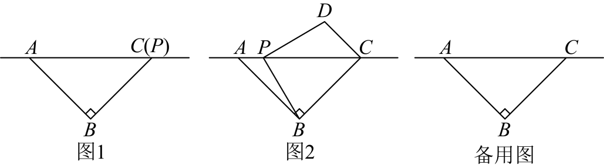

# Mathematics - 题目 2093

**ID**: ec46e204e2134ecba8e0f1eb3556fa3a
**年级**: Grade 8
**难度**: Medium-Hard
**题型**: Calculation

## 题目
如图，在 $\vartriangle ABC$ 中， $\angle ABC=90{}\degree $ ， $AB=BC$ ， $P$ 是直线 $AC$ 上的一动点，将线段 $BP$ 绕点 $P$ 逆时针旋转 $90{}\degree $ 得到 $PD$ ．（1）如图1，当点 $P$ 与点 $C$ 重合时，连接 $BD$ ，根据题意，在图1中画出 $PD$ ， $BD$ ，图中四边形 $ABDC$ 的形状是．（2）当点 $P$ 与点 $\mathrm{A}$ ， $C$ 都不重合时，连接 $DC$ ，试猜想 $DC$ 与 $BC$ 的位置关系，并利用图2证明你的猜想．​​​​​​​‌

## 解答

1. （1）解：如图，∵点P与点C重合，
2. 
3. ∴ $\angle BCD=\angle ABC=90{}\degree $ ， $DC=BC=AB$ ，
4. ∴ $DC/\mskip-4mu/AB$ ，
5. ∴四边形 $ABDC$ 是平行四边形．
6. （2）解：结论： $DC\bot BC$ ，理由如下：
7. 如图，作 $PE\bot AC$ 交 $AB$ 于点E，连接 $DE$ ，则 $\angle APE=90{}\degree $ ，
8. 
9. ∴ $\angle EPD=\angle APB=90{}\degree +\angle BPE$ ，
10. ∵ $\angle ABC=90{}\degree $ ， $AB=BC$ ，
11. ∴ $\angle BAC=\angle BCA=45{}\degree $ ，
12. ∴ $∠PEA=∠PAE=45{}\degree $ ，
13. ∴ $EP=AP$ ，
14. ∵ $PD=PB$ ，
15. ∴ $\vartriangle PED≌\vartriangle PAB\left ({{\rm{S}}{\rm{A}}{\rm{S}}}\right )$ ，
16. ∴ $ED=AB$ ， $\angle PED=\angle PAB=45{}\degree $ ，
17. ∴ $ED=BC$ ， $\angle AED=\angle PEA+\angle PED=90{}\degree =\angle ABC$ ，
18. ∴ $ED{\rm{/\mskip-4mu/}}BC$ ，
19. ∴四边形 $BCDE$ 是平行四边形，
20. ∵ $\angle EBC=90{}\degree $ ，
21. ∴四边形 $BCDE$ 是矩形，
22. ∴ $\angle BCD=90{}\degree $ ，
23. ∴ $DC\bot BC$ ．

## 知识点

**中文**:
  - 一组对边平行且相等的四边形是平行四边形
  - 矩形的判定
  - 旋转的性质
  - 全等三角形的判定与性质

**English**:
  - One Pair of Parallel and Equal Opposite Sides
  - Determination of Rectangles
  - Properties of Rotation
  - Determination and Properties

---
