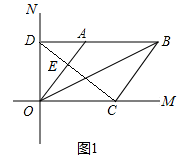
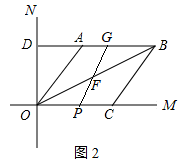

# Mathematics - 题目 3666

**ID**: ee7ba53bbd134ab69c0b87be07602339
**年级**: Grade 8
**难度**: Medium-Hard
**题型**: Calculation

## 题目
已知，如图，直线 $OM\bot ON$ ，点 $C$ 在射线 $OM$ 上， $OC=5$ ，点 $D$ 在射线 $ON$ 上， $OD=4$ ，过点 $D$ 作 $DB//OC$ ， $DB=8$ ，点 $A$ 为线段 $BD$ 上，且 $AB=OC$ .​​​​​​​‌（1） $OA$ 与 $CD$ 交于点 $E$ ，则 $\Delta OCE$ 的面积与 $ΔADE$ 的面积之差为.（2）动点 $P$ 从点 $O$ 出发沿射线 $OC$ 以每秒2个单位的速度运动， $F$ 为 $OB$ 的中点， $PF$ 交线段 $BD$ 于点 $G$ ，设点 $P$ 的运动时间为 $t$ ，试用含 $t$ 的式子表示线段 $PG$ 的长.（3）在（2）的条件下，点 $P$ 在运动的同时动点 $Q$ 从 $O$ 出发以每秒1个单位的速度沿线段 $OD$ 向终点 $D$ 运动.当点 $Q$ 停止运动时，点 $P$ 随之停止运动.在 $P$ 、 $Q$ 运动的过程中，线段 $BD$ 上是否存在点 $R$ ，使得以 $R$ 、 $D$ 、 $Q$ 为顶点的三角形与 $ΔOPQ$ 全等？若存在，请求出 $DR$ 的长；若不存在，请说明理由.

## 解答

1. 解：（1）如图1， $\because OM\bot ON$ ， $DB//OC$ ， $\therefore BD\bot ON$ ，
2. $\because AB=OC=5$ ， $DB=8$ ， $\therefore AD=3$ ，
3. $\therefore S{{}_{\Delta OCE}}-S{{}_{\Delta ADE}}=S{{}_{\Delta OCD}}-S{{}_{\Delta AOD}}=\frac {1}{2}\times 5\times 4-\frac {1}{2}\times 3\times 4=10-6=4$ .
4. 故答案为 $4$ ；
5. （2）当 $0\leqslant t\leqslant 2.5$ 时，如图2中，  $\because BD\parallel OC$ ， $\therefore \angle GBF=\angle POF$ ，
6. 
7. 在 $ΔBGF$ 和 $ΔOPF$ 中，
8. $\begin{cases}\angle GBF=\angle POF\\BF=OF\\\angle GFB=\angle PFO\end{cases}$ ，
9. $\therefore \Delta BGF≌\Delta OPF$ ，
10. $\therefore OP=BG=2t$ ，
11. $\therefore AG=AB-BG=5-2t$  ，
12. 当 $t>2.5$ 时，如图3中，
13. 
14. $\because BG=OP=2t$ ， $\therefore AG=BG-AB=2t-5$ ；
15. 综上，当 $0\leqslant t\leqslant 2.5$ 时， $AG=5-2t$ ，当 $t＞2.5$ 时， $AG{\rm{=}}2t-5$ ；
16. （3）如图4中，当 $DQ=OQ，DR=OP$ 时， $\Delta POQ≌\Delta RDQ$ ，
17. 此时 $DQ=OQ=2$ ， $OP=2OQ=4$ ， $\therefore DR=4$ ；
18. 
19. 如图5中，当 $OQ=DR$ ， $DQ=OP$ 时， $\Delta POQ≌\Delta QDR$  ，
20. 此时 $4-t=2t$ ，  $\therefore t=\frac {4}{3}$ ， $\therefore DR=OQ=\frac {4}{3}$ ．
21. 
22. 综上所述，线段 $BD$ 上存在点 $R$ ，使得以 $R$ 、 $D$ 、 $Q$ 为顶点的三角形与 $ΔOPQ$ 全等，且 $DR=4$ 或 $\frac {4}{3}$ ．
23. 【点睛】本题是三角形的综合题，重点考查了全等三角形的判定和性质，解题的关键是熟练掌握全等三角形的判定和性质，学会分类讨论和用数形结合的数学思想去分析解决问题．

## 知识点

**中文**:
  - 三角形的综合
  - 全等三角形的判定与性质

**English**:
  - Comprehensive Triangle Problems
  - Determination and Properties

---
