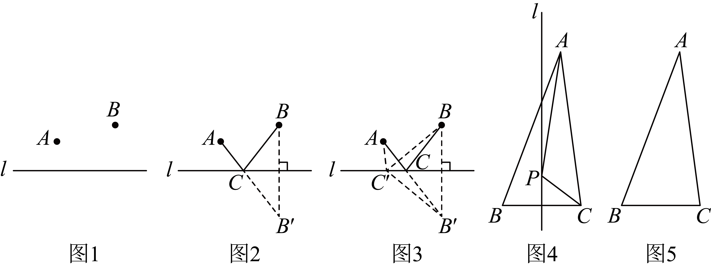

# Mathematics - 题目 2044

**ID**: f3064e202e544136a07f3b0b018109a0
**年级**: Grade 8
**难度**: Medium-Hard
**题型**: Calculation

## 题目
综合与实践材料一：将军饮马问题是一个经典的几何最值问题，源于古希腊时期，数学家海伦利用轴对称的知识成功的解决了这个问题，体现了早期数学家对路径优化的探索．材料二：如图1，已知直线 $l$ 上方 $A$ ， $B$ 两个定点，在直线 $l$ 上找一个点 $C$ ，使得 $AC+CB$ 最小．小军同学给出以下解答：如图2，作点 $B$ 关于直线 $l$ 的对称点 $B^{′}$ ，连结 $AB^{′}$ 与直线 $l$ 交于点 $C$ ，此时 $AC+CB$ 最小．证明过程如图3，在直线 $l$ 上另取任意一点 $C^{′}$ （与点C不重合），连接 $AC^{′}$ ， $BC^{′}$ ， $B^{′}C^{′}$ ．∵点 $B$ 与点 $B^{′}$ 关于直线 $l$ 对称，∴直线 $l$ 是 $BB^{′}$ 的垂直平分线，∴ $CB=$， $C^{′}B=$，∴ $AC+CB=AC+$ _=_；​​​​​​​‌∵在 $\mathrm{△}AB^{′}C^{′}$ 中， $AB^{′}<AC^{′}+C^{′}B^{′}$ ，∴ $AC+CB<AC^{′}+C^{′}B^{′}$ ，即 $AC+CB$ 最小．任务一：完成材料二的填空．任务二：如图4，在 $\vartriangle ABC$ 中，直线 $l$ 是 $BC$ 边的垂直平分线，点 $P$ 是直线 $l$ 上的动点．若 $AB=12\sqrt {3}+5$ ， $AC=24$ ， $BC=13$ ，求 $\mathrm{△}APC$ 周长的最小值．任务三：如图5，在（2）的条件下，已知点 $D$ ， $E$ ， $F$ 分别是 $BC$ ， $AB$ ， $AC$ 上的点，若 $\angle A=30{}\degree $ ，则 $\vartriangle DEF$ 周长的最小值为．

## 解答

1. 解：（1）有对称性可知： $CB^{′}$ ， $C^{′}B^{′}$ ， $CB^{′}$ ， $AB^{′}$
2. （2）如图4，当点 $P$ 运动到直线 $l$ 与 $AB$ 的交点时， $\vartriangle PAC$ 周长最小，
3. $\vartriangle PAC$ 周长 $=PA+PC+AC=PA+PB+AC=AB+AC$ ，
4. ∵ $AB=12\sqrt {3}+5$ ， $AC=24$ ，
5. ∴ $\vartriangle PAC$ 的周长为 $12\sqrt {3}+5+24=12\sqrt {3}+29$ ．
6. （3）如图5，过点 $A$ 作 $AD⊥BC$ ，垂足为点 $D$ ，过点 $D$ 分别作 $AB$ ， $AC$ 的对称点 $M$ ， $N$ ，连接 $MN$ ，交 $AB$ 于点 $E$ ，交 $AC$ 于点 $F$ ，则 $\vartriangle DEF$ 的周长最小，
7. 有对称性可知： $AM=AN=AD$ , $\angle MAB=\angle BAD,\angle DAC=\angle NAC$ ,
8. ∵ $\angle BAC=30{}\degree $ ，
9. ∴ $\angle MAN=2\angle BAD+2\angle DAC=2\angle BAC=60{}\degree $ ，
10. ∴ $\vartriangle AMN$ 是等边三角形,
11. ∴ $MN=AM=AD$ ,
12. ∴ $\vartriangle DEF$ 的周长 $=DE+EF+DF=ME+EF+FN=MN=AD$ ，
13. 如图6，过点 $C$ 作 $CG\bot AB$ 于点 $G$ ，过点 $A$ 作 $AD⊥BC$ 于点 $D$ ，
14. ∵ $\angle BAC=30{}\degree $ ，
15. ∴ $CG=\frac {1}{2}AC=12$ ，
16. ∵ $S{{}_{\mathrm{△}ABC}}=\frac {1}{2}\cdot BC\cdot AD=\frac {1}{2}\cdot AB\cdot CG$ ，
17. ∴ $AD=\frac {AB\cdot CG}{BC}=\frac {\left ({12\sqrt {3}+5}\right )\cdot 12}{13}=\frac {144\sqrt {3}+60}{13}$ ．
18. ∴ $\vartriangle DEF$ 周长的最小值为 $\frac {144\sqrt {3}+60}{13}$ ．
19. 

## 知识点

**中文**:
  - 最短路径问题
  - 等边三角形的判定与性质
  - 轴对称的性质

**English**:
  - Shortest Path Problems
  - Determination and Properties
  - Properties of Axial Symmetry

---
