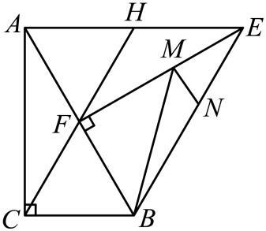

# Mathematics - 题目 2927

**ID**: f6b1bb48406e402f87a9c9c436288c43
**年级**: Grade 8
**难度**: Medium-Hard
**题型**: Calculation

## 题目
如图，在 $\vartriangle ABC$ 中， $\angle ACB=90{}\degree ,\angle CAB=30{}\degree $ ，将 $\vartriangle ABC$ 绕点 $B$ 顺时针旋转一定角度后得到 $\mathrm{△}EBF$ ，点 $F$ 恰好落在 $AB$ 边上，连接 $CF$ 并延长交 $AE$ 于点 $H$ ．（1）求证： $HE=HF$ ；​​​​​​​‌（2）判断四边形 $BCHE$ 的形状，并说明理由；（3）若 $BC=1$ ，点 $M$ ， $N$ 分别为线段 $EF$ ， $BE$ 上的一个动点，连接 $BM$ ， $MN$ ，则 $BM+MN$ 的最小值为．

## 解答

1. （1）证明：∵在 $\vartriangle ABC$ 中， $\angle ACB=90{}\degree ,\angle CAB=30{}\degree $ ，
2. ∴ $∠ABC=180{}\degree -90-30{}\degree =60{}\degree $ ，
3. 由旋转的性质可得 $BC=BF，AB=EB，∠ABE=∠CBF=60{}\degree $ ， $\angle BFE=\angle BCA=90{}\degree $ ， $∠BEF=∠BAC=30{}\degree $ ，
4. ∴ $△BCF，△ABE$ 都是等边三角形，
5. ∴ $∠BFC=∠BEA=60{}\degree $ ，
6. ∴ $\angle HFE=180{}\degree -\angle BFE-\angle BFC=30{}\degree $ ， $∠HEF=∠BEA-∠BEF=30{}\degree $ ，
7. ∴ $\angle HFE=\angle HEF$ ，
8. ∴ $HF=HE$ ；
9. （2）解：四边形 $BCHE$ 是平行四边形，理由如下：
10. ∵ $△BCF，△ABE$ 都是等边三角形，
11. ∴ $∠BCF=∠BEA=60{}\degree $ ，
12. ∵ $∠CBE=∠CBF+∠ABE=120{}\degree $ ，
13. ∴ $∠BCH+∠CBE=∠BEH+∠CBE=180{}\degree $ ，
14. ∴ $BC/\mskip-4mu/EH，CH/\mskip-4mu/BE$ ，
15. ∴四边形 $BCHE$ 是平行四边形；
16. （3）解；如图所示，连接 $AM，AN$ ，
17. 
18. ∵ $\vartriangle ABE$ 是等边三角形， $\angle BFE=90{}\degree $ ，即 $EF\bot AB$ ，
19. ∴ $EF$ 垂直平分 $AB$ ，
20. ∴ $AM=BM$ ，
21. ∴ $BM+MN=AM+MN$ ，
22. ∴当A、M、N三点共线且 $AN⊥BE$ 时， $AM+MN$ 有最小值，即此时 $BM+MN$ 有最小值，最小值为 $AN$ 的长，
23. ∵此时 $EF，AN$ 都是等边三角形 $\vartriangle ABE$ 的高，
24. ∴ $AN=EF$ ，
25. 由旋转的性质可得 $BF=BC=1$ ，
26. ∴ $BE=2BF=2$ ，
27. ∴ $AN=EF=\sqrt {BE{^{2}}-BF{^{2}}}=\sqrt {3}$ ，
28. ∴ $BM+MN$ 的最小值为 $\sqrt {3}$ ．

## 知识点

**中文**:
  - 平行四边形的判定
  - 等边三角形的判定与性质
  - 旋转的性质

**English**:
  - Determination of Parallelograms
  - Determination and Properties
  - Properties of Rotation

---
