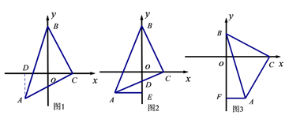

# Mathematics - 题目 2299

**ID**: f6e33be6048b40beafa0106fc83dca4e
**年级**: Grade 8
**难度**: Medium-Hard
**题型**: Calculation

## 题目
如图所示：△ABC是等腰直角三角形，BC=AC，直角顶点C在x轴上，一锐角顶点B在y轴上.​​​​​​​‌（1）如图1所示，若C的坐标是（2，0），点A的坐标是（﹣2，﹣2），求：点B的坐标；（思路提示：过点A作AD⊥x轴于点D，通过证明△BOC≌△CDA来达到目的.）（2）如图2，若y轴恰好平分∠ABC，AC与y轴交于点D，过点A作AE⊥y轴 于E，问BD与AE有怎样的数量关系，并说明理由；（3）如图3，直角边BC的两个端点在两坐标轴上滑动，使点A在第四象限内，过A点作AF⊥y轴于F，在滑动的过程中，两个结论① $\frac {OC-AF}{OB}$ 为定值；② $\frac {OC+AF}{OB}$ 为定值，只有一个结论成立，请你判断正确的结论加以证明，并求出定值．

## 解答

1. （1）过点A作AD⊥x轴，
2. 
3. ∵∠DAC+∠ACD=90°，∠ACD+∠BCD=90°，
4. ∴∠BCD=∠DAC，
5. 在△ADC和△COB中，
6. ，
7. ∴△ADC≌△COB（AAS），
8. ∴AD=OC，CD=OB，
9. ∴点B坐标为（0，4）；
10. （2）延长BC，AE交于点F，
11. 
12. ∵AC=BC，AC⊥BC，
13. ∴∠BAC=∠ABC=45°，
14. ∵BD平分∠ABC，
15. ∴∠COD=22.5°，∠DAE=90°﹣∠ABD﹣∠BAD=22.5°，
16. 在△ACF和△BCD中，
17. ，
18. ∴△ACF≌△BCD（ASA），
19. ∴AF=BD，
20. 在△ABE和△FBE中，
21. ，
22. ∴△ABE≌△FBE（ASA），
23. ∴AE=EF，    ∴BD=2AE；
24. （3）作AE⊥OC，则AF=OE，
25. 
26. ∵∠CBO+∠OBC=90°，∠OBC+∠ACO=90°，
27. ∴∠ACO=∠CBO，
28. 在△BCO和△ACE中，
29. ，
30. ∴△BCO≌△ACE（AAS），  ∴CE=OB，  ∴OB+AF=OC．
31. ∴=1．
32. 【点睛】本题考查了全等三角形的判定及性质，再本题中的每一问都找出全等三角形并证明其全等是解题的关键．

## 知识点

**中文**:
  - 角角边(AAS)
  - 角边角(ASA)

**English**:
  - AAS (Angle-Angle-Side)
  - ASA (Angle-Side-Angle)

---
