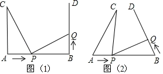

# Mathematics - 题目 756

**ID**: fcc7e29b94f84a158f69c6d9c447f511
**年级**: Grade 8
**难度**: Medium-Hard
**题型**: Calculation

## 题目
如图（1），AB＝4cm，AC⊥AB，BD⊥AB，AC＝BD＝3cm．点P在线段AB上以1cm/s的速度由点A向点B运动，同时，点Q在线段BD上由点B向点D运动．它们运动的时间为t（s）．（1）若点Q的运动速度与点P的运动速度相等，当t＝1时，△ACP与△BPQ是否全等，并判断此时线段PC和线段PQ的位置关系，请分别说明理由；​​​​​​​‌（2）如图（2），将图（1）中的“AC⊥AB，BD⊥AB”为改“∠CAB＝∠DBA＝60°”，其他条件不变．设点Q的运动速度为xcm/s，是否存在实数x，使得△ACP与△BPQ全等？若存在，求出相应的x、t的值；若不存在，请说明理由．

## 解答

1. 解：（1）当 $t=1$ 时， $AP=BQ=1$ ， $BP=AC=3$ ，
2. 又 $\because \angle A=\angle B=90{}^\circ $ ，
3. 在 $ΔACP$ 和 $ΔBPQ$ 中，
4. $\begin{cases}AP=BQ\\\angle A=\angle B\\AC=BP\end{cases}$
5. $\therefore ΔACP\cong ΔBPQ\left ({SAS}\right )$ ．
6. $\therefore \angle ACP=\angle BPQ$ ，
7. $\therefore \angle APC+\angle BPQ=\angle APC+\angle ACP=90{}^\circ $ ．
8. $\therefore \angle CPQ=90{}^\circ $ ，
9. 即线段 $PC$ 与线段 $PQ$ 垂直．
10. （2）①若 $ΔACP\cong ΔBPC$ ，
11. 则 $AC=BP$ ， $AP=BQ$ ，
12. 则 $\begin{cases}3=4-t\\t=xt\end{cases}$ ，
13. 解得： $\begin{cases}t=1\\x=1\end{cases}$ ；
14. ②若 $\Delta ACP\cong \Delta BQP$ ，
15. 则 $AC=BQ$ ， $AP=BP$ ，
16. 则 $\begin{cases}3=xt\\t=4-t\end{cases}$ ，
17. 解得： $\begin{cases}t=2\\x=\frac {3}{2}\end{cases}$ ；
18. 综上所述，存在 $\begin{cases}t=1\\x=1\end{cases}$ 或 $\begin{cases}t=2\\x=\frac {3}{2}\end{cases}$ 使得 $ΔACP$ 与 $ΔBPQ$ 全等．

## 知识点

**中文**:
  - 全等三角形的判定
  - 全等三角形的性质

**English**:
  - Determination of Congruent Triangles
  - Properties of Congruent Triangles

---
