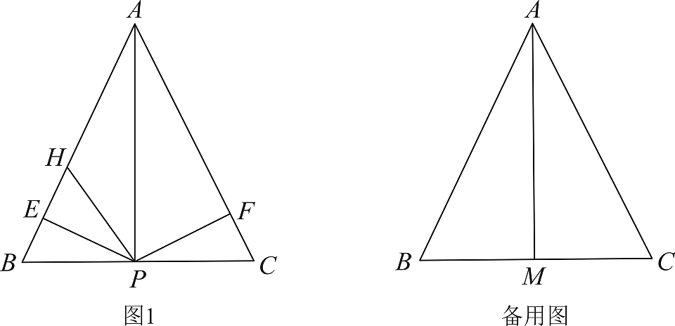

# Mathematics - 题目 330

**ID**: ff836cac41bf45428d34dae328c6d9e9
**年级**: Grade 8
**难度**: Medium-Hard
**题型**: Calculation

## 题目
等腰 $\vartriangle ABC$ 中， $AB=AC$ ， $\angle BAC=α$ ，点 $P$ 为 $\vartriangle ABC$ 角平分线 $AM$ 上一点，点 $E$ 、 $F$ 分别在边 $AB$ 、 $AC$ 上， $\angle EPF=180{}\degree -α$ ，且点 $\mathrm{A}$ 在 $\angle EPF$ 的内部，在 $EA$ 上截 $EH=FC$ .​​​​​​​‌（1）如图1，若点 $P$ 与点 $M$ 重合，且 $\angle AEP=90{}\degree $ ．①求证： $PE=PF$ ；②判断 $HC$ 和 $AB$ 的位置关系，并证明；（2）若点 $P$ 与线段 $AM$ 两个端点均不重合，且 $BC=BE+CF$ ，请直接写出 $∠APC$ 的大小（用含 $α$ 的式子表示）．

## 解答

1. （1）①证明：在四边形 $AEPF$ 中， $\angle BAC=α$ ， $\angle EPF=180{}\degree -α$ ， $\angle AEP=90{}\degree $ ，
2. ∴ $\angle AFP=360{}\degree -\angle BAC-\angle EPF-\angle AEP=90{}\degree $ ，
3. ∴ $PF\bot AC$ ， $PE\bot AB$ ，
4. 又∵ $AP$ 为 $∠BAC$ 的平分线，
5. ∴ $PE=PF$ ；
6. ② $HC\bot AB$ ．
7. 证明：由①已证： $PE=PF$ ， $\angle AFP=90{}\degree $ ，
8. ∴ $\angle PFC=90{}\degree =\angle PEH$ ．
9. 在 $△PEH$ 和 $\mathrm{△}PFC$ 中
10. $\begin{cases}PE=PF\\\angle PEH=\angle PFC\\EH=FC\end{cases}$
11. ∴ $\mathrm{△}PEH≌\mathrm{△}PFC$ （ ${\rm{S}}{\rm{A}}{\rm{S}}$ ）
12. ∴ $PH=PC$ ，
13. ∴ $\angle 1=\angle 2$ ，
14. 
15. 又∵ $AB=AC$ ， $AP$ 为 $∠BAC$ 的平分线，
16. ∴ $PB=PC$ ，
17. ∴ $PB=PH$ ，
18. ∴ $\angle 3=\angle B$ ，
19. 又∵在 $\mathrm{△}BHC$ 中， $\angle 1+\angle 2+\angle 3+\angle B=180{}\degree $ ，
20. ∴ $\angle BHC=\angle 1+\angle 3=90{}\degree $ ．
21. ∴ $HC\bot AB$ ；
22. （2）当 $AB>BC$ 时，在 $AC$ 上任取点 $F$ ，在 $AB$ 上取 $H$ ，使得 $BH=BC$ ，
23. 在 $BH$ 上取点 $E$ ，使得 $EH=FC$ ，关于 $AD$ 作 $E$ 点的对称点 $E^{′}$ ，连接 $PE{^{\prime }}$ ，
24. 
25. ∴ $\angle AEP=\angle AE^{′}P$ ， $PE=PE^{′}$ ，
26. ∵ $\angle EPF=180{}\degree -α$ ，
27. 即 $\angle EPF+\angle BAC=180{}\degree $ ，
28. ∴ $\angle AEP+\angle AFP=180{}\degree $ ，
29. ∵ $\angle AE^{′}P+\angle PE^{′}F=180{}\degree $ ，
30. ∴ $\angle PE^{′}F=\angle PFE^{′}$ ，
31. ∴ $\angle PE^{′}=PF$ ，
32. ∴ $PF=PE,\angle PFC=\angle PEH$ ，
33. 在 $△PEH$ 和 $\mathrm{△}PFC$ 中，
34. $\left \{\hspace{-0.5em}\begin{array}{}\hspace{-0.5em}\begin{array}{}PE=PF\\\angle PEH=\angle PFC\end{array}\hspace{-0.5em}\\EH=FC\end{array}\hspace{-0.5em}\right.$ ，
35. ∴ $\vartriangle PEH{\rm{≌}}\vartriangle PFC({\rm{S}}{\rm{A}}{\rm{S}})$ ，
36. ∴ $PH=PC$ ，
37. 在 $\vartriangle HBP$ 和 $\vartriangle CBP$ 中，
38. $\left \{\hspace{-0.5em}\begin{array}{}\hspace{-0.5em}\begin{array}{}BH=BC\\BP=BP\end{array}\hspace{-0.5em}\\PH=PC\end{array}\hspace{-0.5em}\right.$ ，
39. ∴ $\vartriangle HBP{\rm{≌}}\vartriangle CBP({\rm{S}}{\rm{S}}{\rm{S}})$ ，
40. ∴ $\angle HBP=\angle CBP=\frac {1}{2}\angle ABC=\frac {1}{2}\times \frac {180{}\degree -α}{2}=45{}\degree -\frac {α}{4}$ ，
41. ∵点 $P$ 在 $AD$ 上，
42. ∴ $PB=PC$ ，
43. ∴ $\angle PCB=\angle PBC=45{}\degree -\frac {α}{4}$ ，
44. ∴ $\angle DPC=90{}\degree -(45{}\degree -\frac {α}{4})=45{}\degree +\frac {α}{4}$ ，
45. ∴ $\angle APC=180{}\degree -\angle DPC=180{}\degree -(45{}\degree +\frac {α}{4})=135{}\degree -\frac {α}{4}$ ；
46. 当 $AB<BC$ 时，
47. 
48. 同理可得 $\angle APC=135{}\degree -\frac {α}{4}$ ；
49. 当 $AB=BC$ 时，则点 $H$ 与点 $\mathrm{A}$ 重合，
50. ∴ $\vartriangle ABC$ 为等边三角形，
51. ∴ $α=60{}\degree $ ，
52. 
53. 同理可证 $PH=PC$ ，
54. ∴ $\angle PAC=\angle PCA=\frac {1}{2}α=30$ ，
55. ∴ $\angle APC=180{}\degree -30{}\degree -30{}\degree =120{}\degree =135{}\degree -\frac {α}{4}$ ；
56. 综上所述： $\angle APC=135{}\degree -\frac {α}{4}$ ．

## 知识点

**中文**:
  - 两直线平行同位角相等
  - 角平分线的性质
  - 等腰三角形的判定与性质
  - 全等三角形的判定与性质

**English**:
  - Parallel Lines have Equal Corresponding Angles
  - Properties of Angle Bisectors
  - Determination and Properties
  - Determination and Properties

---
