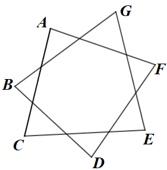

# Mathematics - 题目 2238

**ID**: 2360bac41a9d4e72bb9c3c955c629c3f
**年级**: Grade 8
**难度**: Medium-Hard
**题型**: Fill-in-the-blank

## 题目
如图，如图，∠A+∠B+∠C+∠D+∠E+∠F+∠G=．​​​​​​​‌

## 解答

1. 解：如图，连接BC、AD．
2. 
3. 在四边形BCEG中，得∠E+∠G+∠ECB+∠GBC=360°，
4. 又因为∠1+∠2=∠3+∠4，∠5+∠6+∠F=180°，
5. ∠4+∠5+∠3+∠6=∠CAF+∠BDF，即∠1+∠2+∠5+∠6=∠CAF+∠BDF，
6. 所以∠CAF+∠B+∠C+∠BDF+∠E+∠F+∠G=540°，
7. 即∠A+∠B+∠C+∠D+∠E+∠F+∠G=540°．
8. 故答案为：540°．

## 知识点

**中文**:
  - 多边形的内角

**English**:
  - Interior Angles of Polygons

---
