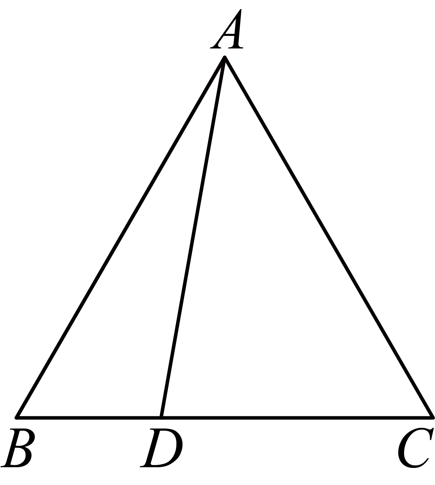

# Mathematics - 题目 1957

**ID**: 725fabb9f59f488c946b18d1a507ab8d
**年级**: Grade 8
**难度**: Medium-Hard
**题型**: Fill-in-the-blank

## 题目
如图，点D是等边 $\mathrm{△}ABC$ 边 $BC$ 上一点，且  $\angle BAD=20{}\degree $ ．将 $\mathrm{△}ABD$ 绕点A顺时针旋转α（ $α\ne 0$ ）得到 $\mathrm{△}AB^{′}D^{′}$ ，其中点B，D的对应点分别为 $B{^{\prime }}，D{^{\prime }}$ ．当直线 $B^{′}D^{′}$ 经过 $\mathrm{△}ABC$ 的顶点时， $\mathrm{∠}CDD^{′}$ 的度数为．​​​​​​​‌

## 解答

1. 解：由题意知，当直线 $B^{′}D^{′}$ 经过 $\mathrm{△}ABC$ 的顶点时，分 $B^{′}D^{′}$ 经过顶点 $B$ ， $B^{′}D^{′}$ 经过顶点 $C$ ，两种情况求解：
2. 当 $B^{′}D^{′}$ 经过顶点 $B$ 时，如图1，
3. 
4. 由旋转的性质可知， $\angle AB^{′}D^{′}=\angle ABD=60{}\degree $ ， $\angle B^{′}AD^{′}=\angle BAD=20{}\degree $ ， $AB^{′}=AB=AC$ ， $AD^{′}=AD$ ，∴ $△AB^{′}B$ 是等边三角形，∴ $\angle B^{′}AB=60{}\degree $ ，
5. ∴ $\angle D^{′}AB=40{}\degree $ ， $\angle D^{′}AD=60{}\degree $ ，∴ $\mathrm{△}D{^{\prime }}AD$ 是等边三角形，
6. ∴ $\angle ADD^{′}=60{}\degree $ ，∴ $\angle CDD^{′}=\angle ADD^{′}+\angle ADC=\angle ADD^{′}+\left ({\angle ABC+\angle BAD}\right )=140{}\degree $ ；
7. 当 $α=360{}\degree $ 时， $B^{′}，B$ 重合，  $B^{′}D^{′}$ 经过顶点 $B，C$ ，如图2，
8. 
9. 此时 $\angle CDD^{′}=0{}\degree $ ；
10. 当 $B^{′}D^{′}$ 经过顶点 $C$ 时，
11. 当 $\angle ACB^{′}=\angle AB^{′}D^{′}=60{}\degree $ ，此时 $B^{′}，B$ 重合， $\angle CDD^{′}=0{}\degree $ ，
12. 当 $\angle ACB^{′}=180{}\degree -\angle AB^{′}D^{′}=120{}\degree $ ，此时不成立；
13. 当 $B^{′}，C$ 重合，  $B^{′}D^{′}$ 经过顶点 $C$ ，如图3，
14. 
15. 同理， $\mathrm{△}D{^{\prime }}AD$ 是等边三角形，∴ $\angle ADD^{′}=60{}\degree $ ，
16. ∴ $\angle CDD^{′}=\angle ADC-\angle ADD^{′}=\left ({\angle B+\angle BAD}\right )-\angle ADD^{′}=20{}\degree $ ，
17. 综上所述， $\mathrm{∠}CDD^{′}$ 的度数为 $140{}\degree $ 或 $0{}\degree $ 或 $20{}\degree $ ．

## 知识点

**中文**:
  - 等边三角形的判定与性质

**English**:
  - Determination and Properties

---
