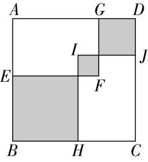

# Mathematics - 题目 1371

**ID**: 76d6632adbf8438c885095cb1cdffe1b
**年级**: Grade 8
**难度**: Medium-Hard
**题型**: Fill-in-the-blank

## 题目
如图，边长为4的正方形 $ABCD$ 中放置两个长、宽分别为 $a$ ， $b$ 的长方形 $AEFG$ 与长方形 $CHIJ$ ，将阴影部分的面积记为 ${S}_{1}$ ，长方形 $AEFG$ 的面积记为 ${S}_{2}$ ，若 $3{S}_{1}+5{S}_{2}=44$ ， $a:b=3:2$ ，则长方形 $AEFG$ 的周长为．​​​​​​​‌

## 解答

1. 如图 ${\rm .}\because a:b=3:2$ ， $\therefore $  设 $a=3x$ ， $b=2x$ ，则 $AG=EF=CJ=HI=3x$ ， $AE=FG=CH=IJ=2x.\because $  正方形 $ABCD$ 的边长为 ${\rm 4，}\therefore AB=BC=CD=AD=4$ ， $\therefore BH=BE=4-2x$ ， $DG=DJ=4-3x$ ， $IP=IQ=3x-(4-2x)=5x-4$ ，则易知四边形 $BEPH$ 、四边形 $IPFQ$ 、四边形 $DGQJ$ 均为正方形， $\therefore {S}_{1}={S}_{正方形BEPH}+{S}_{正方形IPFQ}+{S}_{正方形DGQJ}=(4-2x)^{2}+(5x-4)^{2}+(4-3x)^{2}=16-16x+4{x}^{2}+25{x}^{2}-40x+16+16-24x+9{x}^{2}=38{x}^{2}-80x+48$ .又 $\because {S}_{2}=ab=3x\cdot 2x=6{x}^{2}$ , $\therefore 3{S}_{1}+5{S}_{2}=3(38{x}^{2}-80x+48)+5×6{x}^{2}=44$ ， $\therefore 114{x}^{2}-240x+144+30{x}^{2}=44$ ， $\therefore 144{x}^{2}-240x+100=0$ ， $\therefore 36{x}^{2}-60x+25=0$ ， $\therefore (6x-5)^{2}=0$ ， $\therefore x=\frac{5}{6}$ ， $\therefore {C}_{长方形AEFG}=2(a+b)=2(3x+2x)=10x=10×\frac{5}{6}=\frac{25}{3}$ ．故答案为 $\frac{25}{3}$ ．
2. 

## 知识点

**中文**:
  - 运用完全平方公式分解因式

**English**:
  - Factorization using Perfect Square Trinomials

---
