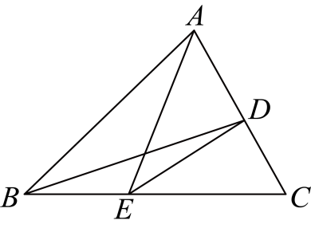

# Mathematics - 题目 3028

**ID**: 8ec8df507d9344359d82be0febfd7ff9
**年级**: Grade 8
**难度**: Medium-Hard
**题型**: Fill-in-the-blank

## 题目
如图，在 $\vartriangle ABC$ 中， $\angle ABC=45{}\degree $ ， $\angle BAC=75{}\degree $ ， $AC=2$ ，点E与点D分别在射线 $BC$ 与射线 $AD$ 上，且 $AD=BE$ ，则 $AE+BD$ 的最小值为， $AE+ED$ 的最小值为．​​​​​​​‌

## 解答

1. 如图所示，过 $\mathrm{A}$ 作 $AF⊥BC$ 交 $BC$ 的于 $F$ ，
2. 
3. ∵ $\angle ABC=45{}\degree $ ， $\angle BAC=75{}\degree $ ，
4. ∴ $\angle ACB=180{}\degree -45{}\degree -75{}\degree =60{}\degree $
5. ∴ $\angle CAF=30{}\degree $ ， $\angle ABC=\angle BAF=45{}\degree $ ，
6. ∵ $AC=2$ ，
7. ∴ $CF=\frac {1}{2}AC=1$ ， $AF=BF=\sqrt {AC{^{2}}-CF{^{2}}}=\sqrt {3}$
8. ∴ $AB=\sqrt {AF{^{2}}+BF{^{2}}}=\sqrt {6}$
9. 如图所示，作 $\angle MAD=45{}\degree $ 且 $AM=AB$ ，连接 $DM$ ， $BM$ ，
10. 
11. ∵ $AB=AM,\angle ABE=\angle MAD=45{}\degree ,BE=AD$
12. ∴ $\vartriangle ABE≌\vartriangle MAD\left ({{\rm{S}}{\rm{A}}{\rm{S}}}\right )$
13. ∴ $AE=DM$
14. ∴ $BD+AE$  $=$  $BD+DM\geqslant BM$ ，
15. 当 $D$ 在 $BM$ 上时， $BD+AE$ 取得最小值，如图所示，过点 $M$ 作 $MN⊥AB$ 交 $BA$ 的延长线于点 $N$ ，
16. 
17. ∵ $\angle BAD=75{}\degree $ ， $\angle DAM=45{}\degree $
18. ∴ $\angle NAM=60{}\degree $ ， $\angle AMN=30{}\degree $
19. ∵ $AB=AM$
20. ∴ $\angle ABM=30{}\degree $
21. ∵ $AM=AB=\sqrt {6}$
22. 在 ${\rm{R}}{\rm{t}}\mathrm{△}ANM$ 中， $AN=\frac {1}{2}AM=\frac {\sqrt {6}}{2}$ ，
23. ∴ $MN=\sqrt {3}AN=\frac {3\sqrt {2}}{2}$
24. ∴ $BM=2MN=3\sqrt {2}$ ，即 $AE+BD$ 的最小值为 $3\sqrt {2}$ ；
25. 如图所示，作 $\mathrm{A}$ 关于 $BM$ 的对称点 $J$ ，连接 $AJ,BJ,MJ$ ,则
26. 
27. ∵ $AB=AM,\angle BAM=120{}\degree $  $AB=AM$ 则 $\angle ABM=\angle JBM=30{}\degree $
28. ∴ $\angle ABJ=60{}\degree $ ，
29. ∵对称，
30. ∴ $BA=BJ$
31. ∴ $\vartriangle ABJ,\vartriangle AMJ$ 都是等边三角形，
32. 连接 $EJ,DJ$ ，
33. ∵ $\vartriangle ABE≌\vartriangle MAD$ ，
34. ∴ $\angle BAE=\angle AMD$ ，则 $\angle EAJ=\angle DMJ$ ，
35. 又∵ $AJ=JM,AE=MD$
36. ∴ $\vartriangle EAJ≌\vartriangle DMJ$
37. ∴ $\angle EJA=\angle DJM$ ， $EJ=DJ$
38. ∴ $\angle EJD=\angle AJM=60{}\degree $
39. ∴ $\mathrm{△}EDJ$ 是等边三角形，
40. ∴ $AE+ED=AE+EJ$  $\geqslant AJ$
41. ∴当 $E$ 在 $AJ$ 上时， $AE+ED=AJ$ ， 如图所示
42. 
43. 此时 $AE+ED$ 取得最小值，最小值 $AJ=AB=\sqrt {6}$

## 知识点

**中文**:
  - 全等三角形的综合问题
  - 等边三角形的判定与性质
  - 勾股定理

**English**:
  - Comprehensive Problems
  - Determination and Properties
  - Pythagorean Theorem

---
