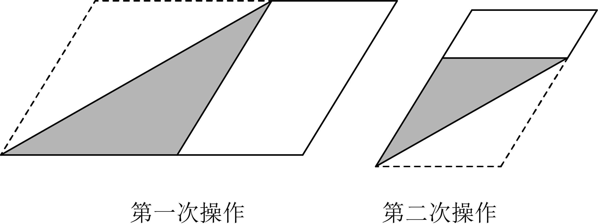

# Mathematics - 题目 2601

**ID**: c22b832576e94c69a1c5f0e92b338d39
**年级**: Grade 8
**难度**: Medium-Hard
**题型**: Fill-in-the-blank

## 题目
邻边长分别为 $3$ ， $a\left ({a>3}\right )$ 的平行四边形纸片，如图那样折一下，剪下一个边长等于 $3$ 的菱形（称为第一次操作）；​​​​​​​‌再把剩下的平行四边形如图那样折一下，剪下一个边长等于此时平行四边形一边长的菱形（称为第二次操作）；再把剩下的平行四边形如此反复操作下去，若在第三次操作后，剩下的平行四边形为菱形，则 $a$ 的值．

## 解答

1. 解：①如图，经历三次折叠后，四边形 $IJHF$ 为菱形，
2. $\because $ 四边形 $ABCD$ 为菱形，
3. $\therefore AB=AD=BC=CD=3$ ，
4. $\therefore DF=CE=a-3$ ，
5. $\because $ 四边形 $GCEH$ 为菱形，
6. $\therefore GC=CE=a-3$ ，
7. $\therefore DG=FH=3-\left ({a-3}\right )=6-a$ ，
8. $\because $ 四边形 $DGJI$ 为菱形，
9. $\therefore DI=DG=6-a$ ，
10. $\therefore IF=a-3-\left ({6-a}\right )=2a-9$ ，
11. $\because $ 四边形 $IJHF$ 为菱形，
12. $\therefore IF=HF$ ，即 $6-a=2a-9$ ，
13. 解得： $a=5$ ；
14. ②如图，经历三次折叠后，四边形 $DIHF$ 为菱形，
15. $\because $ 四边形 $ABCD$ 为菱形，
16. $\therefore AB=AD=BC=CD=3$ ，
17. $\therefore DF=CE=a-3$ ，
18. $\because CE=CJ=JG=IJ=IH=DI=a-3$ ，
19. ∵四边形 $JCEG$ ， $IJGH$ ， $DIHF$ 都为菱形，
20. $\therefore DI=\frac {1}{3}CD=1$ ，
21. $\therefore a-3=1$ ，
22. 解得： $a=4$ ；
23. $\therefore $ 综上所述， $a$ 的值为 $5$ 或 $4$ ．

## 知识点

**中文**:
  - 菱形的性质

**English**:
  - Properties of Rhombuses

---
