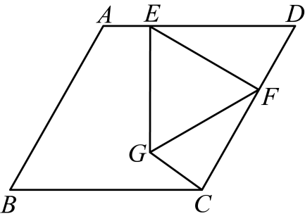

# Mathematics - 题目 3121

**ID**: d6fbfaea86494622979390ae94638901
**年级**: Grade 8
**难度**: Medium-Hard
**题型**: Fill-in-the-blank

## 题目
如图，四边形 $ABCD$ 是菱形， $AB=10,\angle B=60{}\degree $ ，点E是边 $AD$ 上一点，且 $AE=2$ ，点F是边 $CD$ 上一个动点，以 $EF$ 为边作等边 $\vartriangle EFG$ ，连接 $CG$ ．若 $CG$ 的长度为d，则d的取值范围是．​​​​​​​‌

## 解答

1. 解：在 $DC$ 上截取 $DQ=DE$ ，连接 $QE$ ，连接 $QG$ ，并延长交 $AB$ 于点 $N$ ，连接 $CN$ ，过点C作 $CM\bot NQ$ 于点 $M$ ，
2. 
3. ∵四边形 $ABCD$ 是菱形，
4. ∴ $DA=DC=BC=10$ ， $\angle B=\angle D=60{}\degree $ ， $AD\mathrm{/\mskip-4mu/}BC$ ， $AB/\mskip-4mu/CD$ ，
5. ∵ $AE=2$ ，
6. ∴ $DE=DQ=10-2=8$ ，
7. ∴ $CQ=DC-DQ=10-8=2$ ，
8. ∴ $\vartriangle DEQ$ 为等边三角形，
9. ∴ $ED=EQ,\angle DEQ=60{}\degree $ ，
10. ∵等边 $\mathrm{△}EGF$ ，
11. ∴ $EG=EF$ ， $\angle GEF=60{}\degree $ ，
12. ∴ $\angle GEF=\angle DEQ$ ，
13. ∴ $\angle DEF=\angle QEG$ ，
14. ∴ $\vartriangle DEF≌\vartriangle QEG\left ({{\rm{S}}{\rm{A}}{\rm{S}}}\right )$ ，
15. ∴ $\angle EQG=\angle D=60{}\degree $ ，
16. ∴ $\angle EQG=\angle DEQ=60{}\degree $ ，
17. ∴ $NQ/\mskip-4mu/AD$ ，
18. ∴ $\angle NQC=\angle D=60{}\degree $ ，
19. ∵ $AD\mathrm{/\mskip-4mu/}BC$ ，
20. ∴ $NQ\parallel BC$ ，
21. ∵ $AB/\mskip-4mu/CD$ ，
22. ∴四边形 $BNQC$ 是平行四边形，
23. ∴ $NQ=BC=10$ ，
24. ∴在 ${\rm{R}}{\rm{t}}△CMQ$ 中， $\angle MCQ=90{}\degree -\angle NQC=30{}\degree $ ，
25. 
26. 则 $MQ=\frac {1}{2}CQ=1,$  $CM=\sqrt {CQ{^{2}}-MQ{^{2}}}=\sqrt {3}$ ，
27. ∴ $MN=NQ-MQ=10-1=9$ ，
28. ∴ ${\rm{R}}{\rm{t}}\mathrm{△}CNM$ 中， $CN=\sqrt {CM{^{2}}+MN{^{2}}}=\sqrt {{\left({\sqrt {3}}\right)^{2}}+9{^{2}}}=2\sqrt {21}$ ，
29. ∵ $\angle NQC=60{}\degree $ ，
30. ∴点 $G$ 在线段 $NQ$ 上运动，
31. ∴当点 $G$ 与点 $M$ 重合时， $CG$ 最小为 $\sqrt {3}$ ，当点 $G$ 与点 $N$ 重合时， $CG$ 最大为 $2\sqrt {21}$ ，
32. ∴ $\sqrt {3}\leqslant d\leqslant 2\sqrt {21}$ .

## 知识点

**中文**:
  - 平行四边形的判定与性质
  - 等边三角形的判定与性质
  - 菱形的性质

**English**:
  - Determination and Properties
  - Determination and Properties
  - Properties of Rhombuses

---
