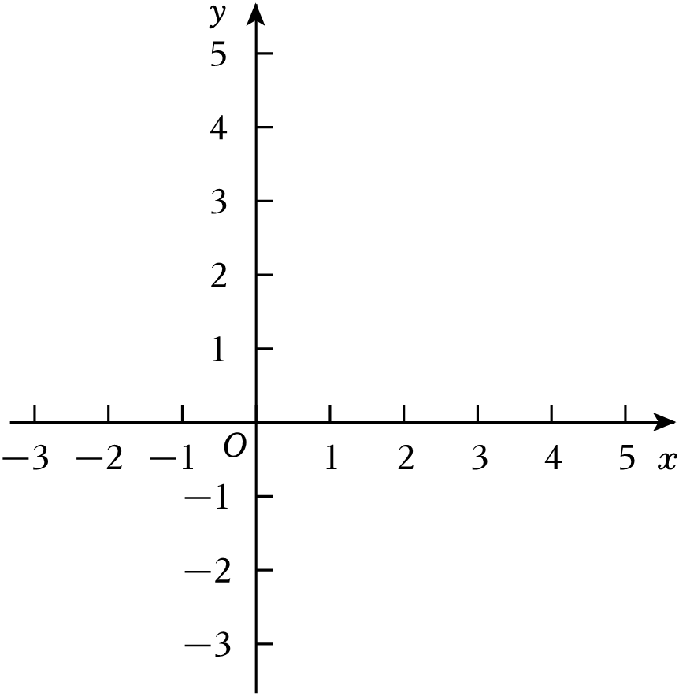

# Mathematics - 题目 2727

**ID**: d98f56ae627d47da8314df9e07ab6e59
**年级**: Grade 8
**难度**: Medium-Hard
**题型**: Fill-in-the-blank

## 题目
在平面直角坐标系中，点 $A(2,0)$ ， $B(0,3)$ ， $C(0,2)$ ，点 $D$ 在第二象限，且 ${\rm △}AOB\cong {\rm △}$  $OCD$ ．（1）点 $D$ 的坐标为；​​​​​​​‌（2）点 $P$ 在坐标轴上，且 ${\rm △}PAC$ 是等腰三角形，则 $P$ 点的个数为．

## 解答

1. 解：（1） $\because $ 点 $A(2,0)$ ， $B(0,3)$ ， $C(0,2)$ ，
2. $\therefore OA=2$ ， $OB=3$ ， $OC=2$ ， $\angle AOB=90{}\degree $ ，
3. $\because {\rm △}$  $AOB\cong {\rm △}$  $OCD$ ，
4. $\therefore \angle AOB=\angle OCD=90{}\degree $ ， $OA=OC=2$ ， $OB=CA=3$ ， $AB=OD$ ，如图1所示,
5. 
6. $\because $ 点 $D$ 在第二象限，
7. $\therefore $ 点 $D$ 的坐标为 $(-3,2)$ ，
8. 故答案为 $(-3,2)$ ；
9. （2）在 ${\rm{R}}{\rm{t}}{\rm △}$  $OAC$ 中， $OA=OC=2$ ，
10. 由勾股定理得 $AC=\sqrt {OA{^{2}}+OC{^{2}}}=2\sqrt {2}$ ，
11. $\because $ 点 $P$ 在坐标轴上，且 ${\rm △}PAC$ 是等腰三角形，
12. $\therefore $ 有以下三种情况：
13. ① $\because OA=OC=2$ ，
14. 当点 $P$ 于点 $O$ 重合时，则 $PA=PC$ ，
15. $\therefore $ 点 $O$ 为符合题意的点，如图2所示,
16. 
17. 此时点 $P$ 的坐标为 $(0,0)$ ；
18. ②以点 $A$ 为圆心，以 $AC$ 为 $BA$ 半径画弧交 $x$ 轴于点 $P$ ， $P^{′}$ ，
19. 则 $PA=AC$ ， $P^{′}A=AC$ ，
20. $\therefore $ 点 $P$ ， $P^{′}$ 为符合题意的点，如图3所示,
21. 
22. 此时点 $P(2+2\sqrt {2}$ ， $0)$ ， $P^{′}(2-2\sqrt {2}$ ， $0)$ ；
23. ③以点 $C$ 为圆心，以 $CA$ 为半径画弧交 $y$ 轴于 $P$ ， $P^{′}$ ，
24. 则 $PC=AC$ ， $P^{′}C=AC$ ，
25. $\therefore $ 点 $P$ ， $P^{′}$ 为符合题意的点，如图4所示,
26. 
27. 此时点 $P(0,2+2\sqrt {2})$ ， $P^{′}(0,2-2\sqrt {2})$ ，
28. 综上所述,符合题意的点 $P$ 共有5个．
29. 故答案为 5个．

## 知识点

**中文**:
  - 全等三角形的性质
  - 坐标与图形性质
  - 等腰三角形的性质

**English**:
  - Properties of Congruent Triangles
  - Coordinates and Geometric Properties
  - Properties of Isosceles Triangles

---
