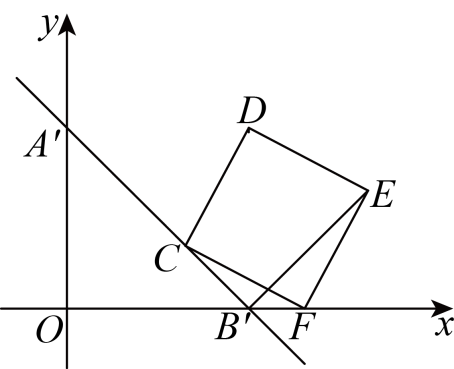

# Mathematics - 题目 3844

**ID**: e8c0aea99b30468cb608bfb59c8ad85b
**年级**: Grade 8
**难度**: Medium-Hard
**题型**: Fill-in-the-blank

## 题目
如图，在平面直角坐标系 $xOy$ 中，将直线 $AB:y=-x+4$ 向上平移 $\left ({m-4}\right )$ 个单位得到直线 $A^{′}B^{′}$ ，点 $C$ 是射线 $A^{′}B^{′}$ 上的一动点，点 $D$ 的坐标是 $(m,m)$ ，以 $CD$ 为边向右作正方形 $CDEF$ ，连接 $B{^{\prime }}E$ ， $B^{′}E=nB^{′}C$ ，其中 $m>4,n>0$ ，点 $E$ 的坐标为（用 $m$ ， $n$ 的式子表示）．​​​​​​​‌

## 解答

1. 解：由 $B^{′}E=nB^{′}C$ ，设 $B^{′}C=\sqrt {2}x$ ，则 $B^{′}E=\sqrt {2}nx$ ，过点 $C$ 作 $y$ 轴的平行线交 $AD$ 于 $M$ ，交 $x$ 轴于 $N$ ，过 $E$ 作 $EQ\bot AD$ 交 $AD$ 的延长线于 $Q$ ，
2. 
3. ∵直线 $AB$ 向上平移 $\left ({m-4}\right )$ 个单位得到直线 $A^{′}B^{′}$ ， $A\left ({0,4}\right )$ ，
4. ∴ $A^{′}{\left ({0,m}\right )}$ ，
5. ∵ $OA=OB$ ， $\angle ABO=\angle BAO=45{}\degree $ ，
6. ∴ $OA^{′}=OB^{′}=m$ ，
7. ∴ $B{^{\prime }}(m,0)$ ， $\angle A^{′}B^{′}O=\angle B^{′}AO=45{}\degree $ ，
8. 连接 $A^{′}D$ ， $B^{′}D$ ，
9. ∵点 $D$ 的坐标是 $\left ({m,m}\right )$ ，
10. ∴ $OA^{′}=OB^{′}=DA^{′}=DB^{′}$ ，
11. 而 $\angle A^{′}OB^{′}=90{}\degree $ ，
12. ∴四边形 $OA^{′}DB^{′}$ 是正方形，
13. ∴ $\angle A^{′}DB^{′}=90{}\degree $ ， $\angle MA^{′}C=\angle MCA^{′}=45{}\degree $ ， $\angle NB^{′}C=\angle NCB^{′}=45{}\degree $ ，
14. ∴ $A^{′}M=CM$ ， $CN=B^{′}N$ ，
15. ∵四边形 $CDEF$ 是正方形，
16. ∴ $\angle CDE=90{}\degree $ ，
17. ∴ $\angle A^{′}DB^{′}=\angle CDE$ ，
18. ∴ $\angle A^{′}DB^{′}-\angle CDB^{′}=\angle CDE-\angle CDB^{′}$ ，
19. ∴ $\angle A^{′}DC=\angle B^{′}DE$ ，
20. 又 $A^{′}D=B^{′}D$ ， $DC=DE$ ，
21. ∴ $△A^{′}DC≌△B^{′}DE$ ，
22. ∴ $A^{′}C=B^{′}E=\sqrt {2}nx$ ，
23. ${\rm （i）}$ 若点 $C$ 在第一象限，
24. 
25. ∵ $\angle MCD+\angle MDC=90{}\degree $ ， $\angle MDC+\angle QDE=90{}\degree $ ，
26. ∴ $\angle MCD=\angle QDE$ ，
27. ∵ $\angle DMC=\angle EQD$ ， $DC=DE$ ，
28. ∴ $△CMD≌△DQE$ ，
29. ∴ $A^{′}M=CM=DQ=nx$ ， $QE=MD=NB^{′}=x$ ，
30. 则 $E\left ({m+nx,m-x}\right )$ ，
31. 又 $A^{′}M+MD=nx+x=m$ ，则 $x=\frac {m}{n+1}$ ，
32. 则 $E\left ({\frac {2mn+m}{n+1},\frac {mn}{n+1}}\right )$ ；
33. ${\rm （ii）}$ 若点 $C$ 在第四象限，
34. ∵ $\angle RDS=\angle CDE=90{}\degree $ ，
35. ∴ $\angle RDC=\angle SDE$ ，
36. 又 $\angle R=\angle S$ ， $DC=DE$ ，
37. ∴ $△CRD≌△ESD$ ，
38. 
39. ∴ $A^{′}C=B^{′}E=\sqrt {2}nx$ ， $ES=RC=B^{′}R=x$ ， $DS=DR=m+x$ ，
40. ∴ $E\left ({2m+x,m+x}\right )$ ，
41. 又 $A^{′}B^{′}=\sqrt {2}nx-\sqrt {2}x=\sqrt {2}m$ ，则 $x=\frac {m}{n-1}$ ，
42. ∴ $E\left ({\frac {2mn-m}{n-1},\frac {mn}{n-1}}\right )$ ，
43. 综上，点 $E$ 的坐标为 $\left ({\frac {2mn+m}{n+1},\frac {mn}{n+1}}\right )$ 或 $\left ({\frac {2mn-m}{n-1},\frac {mn}{n-1}}\right )$ ．

## 知识点

**中文**:
  - 一次函数图象的平移
  - 一次函数的图象和性质
  - 正方形的判定与性质综合
  - 全等三角形的判定与性质

**English**:
  - Translation of Linear Function Graphs
  - Graphs and Properties of Linear Functions
  - Determination and Properties of Squares
  - Determination and Properties

---
