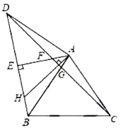

# Mathematics - 题目 577

**ID**: a95079cd19644edd9ba5e916a6fc121c
**年级**: Grade 8
**难度**: Medium-Hard
**题型**: Multiple-choice

## 题目
如图， $\vartriangle ABC$ 是等边三角形， $\mathrm{△}ABD$ 是等腰直角三角形，∠BAD=90°，AE⊥BD于点E．连CD分别交AE，AB于点F，G，过点A作AH⊥CD交BD于点H，则下列结论：① ${\rm ∠\mathit{ADC}=15°}$ ；②AF=AG；③AH=DF；④ ${\rm △\mathit{ADF}}$ ≌ ${\rm △\mathit{BAH}}$ ；⑤DF=2EH.​​​​​​​‌其中正确结论的个数为（      ）

## 解答

1. ①正确：∵ $\vartriangle ABC$ 是等边三角形，
2. ∴ $\angle BAC=60\degree $ ，∴ $CA=AB$ ．
3. ∵ $\mathrm{△}ABD$ 是等腰直角三角形，∴ $DA=AB$ ．
4. 又∵ $\angle BAD=90\degree $ ，∴ $\angle CAD=\angle BAD+\angle BAC=150\degree $ ，
5. ∴ $DA=CA$ ，∴ $\angle ADC=\angle ACD=\frac {1}{2}\left ({180\degree -150\degree }\right )=15\degree $ ；
6. ②错误：∵ ${\rm ∠\mathit{EDF=∠ADB-∠ADC}=30°}$
7. ∴ ${\rm ∠\mathit{DFE}=90°-∠EDF=90°-30°=60°=∠\mathit{AFG}}$
8. ∵ ${\rm ∠\mathit{AGD}=90°-∠\mathit{ADG}=90°-15°=75°}$
9. ${\rm ∠\mathit{AFG≠∠AGD}}$
10. ∴AF≠AG
11. ③，④正确，由题意可得 $\angle DAF=\angle ABH=45\degree $ ， $DA=AB$ ，
12. ∵ $AE\bot BD$ ， $AH\bot CD$ ．∴ $\angle EHG+\angle EFG=180\degree $ ．
13. 又∵ $\angle DFA+\angle EFG=180{\rm{°}}$ ，∴ $\angle EHG=\angle DFA$ ，
14. 在 $\mathrm{△}DAF$ 和 $\vartriangle ABH$ 中
15. $\begin{cases}\angle AFD=\angle BHA\\\angle DAF=\angle ABH\quad (AAS)\\DA=AB\end{cases}$
16. ∴ $\mathrm{△}DAF$ ≌ $\vartriangle ABH$ ．∴ $DF=AH$ ．
17. ⑤正确：∵ $\angle CAD=150\degree $ ， $AH\bot CD$ ，
18. ∴ $\angle DAH=75\degree $ ，又∵ $\angle DAF=45\degree $ ，∴ $\angle EAH=75\degree -45\degree =30\degree $
19. 又∵ $AE\bot DB$ ，∴ $AH=2EH$ ，又∵ $AH{\rm{=}}DF$ ，∴ $DF=2EH$

## 知识点

**中文**:
  - 全等三角形的综合问题
  - 等腰三角形的判定与性质
  - 等边三角形的性质

**English**:
  - Comprehensive Problems
  - Determination and Properties
  - Properties of Equilateral Triangles

---
