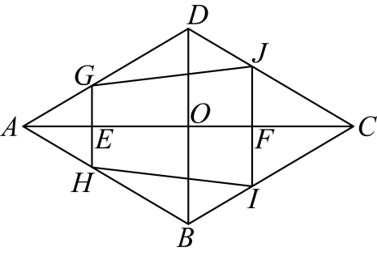

# Mathematics - 题目 3673

**ID**: bd5dea8c1bdf497db8b5f81a18c0da0d
**年级**: Grade 8
**难度**: Medium-Hard
**题型**: Multiple-choice

## 题目
如图，在菱形 $ABCD$ 中， $AC、BD$ 相交于点 $O$ ， $AC=a$ ， $BD=b(a>b)$ ， $E、F$ 分别为 $OA$ 和 $OC$ 上的点（不与点 $A、O、C$ 重合）．其中 $AE=OF$ ．过点 $E$ 作 $GH\bot AC$ ，分别交 $AD、AB$ 于点 $G、H$ ；​​​​​​​‌过点 $F$ 作 $IJ\bot AC$ 分别交 $CD、CB$ 于点 $J、I$ ；连接 $GJ、HI$ ，则下列结论正确的个数是（      ）① $GH+IJ=b$ ；②四边形 $GHIJ$ 的面积等于 $\frac {1}{4}ab$ ；③当 $AE=OE$ 时，四边形 $GHIJ$ 为正方形．

## 解答

1. 解：①如图所示，作 $GM\bot BD$ ，交 $BD$ 于点 $M$ ，连接 $GI$ ，并延长 $HG$ ， $CD$ 交于点 $N$ ，
2. 
3. $\because $  $GM\bot BD$ ，在菱形 $ABCD$ 中 $BD\bot AC$ ，
4. $\therefore $  $GM{\rm{/\mskip-4mu/}}AC$ ，
5. $\because $  $GH\bot AC$ ， $IJ\bot AC$ ，
6. $\therefore $  $GH{\rm{/\mskip-4mu/}}BD{\rm{/\mskip-4mu/}}IJ$ ，
7. $\therefore $ 四边形 $GEOM$ 为矩形，
8. $\therefore $  $GM=EO$ ，
9. $\because $ 在菱形 $ABCD$ 中， $AO=CO$ ， $AE=OF$ ，
10. $\therefore $  $CF=CO-OF=AO-AE=EO$ ，
11. $\therefore $  $GM=CF$ ，
12. $\because $  $\angle DMG=\angle CFI=90{}\degree $ ， $\angle DGM=\angle DAO=\angle ICF$ ，
13. $\therefore $  $\mathrm{△}DGM\cong \mathrm{△}ICF({\rm{A}}{\rm{S}}{\rm{A}})$ ，
14. $\therefore $  $DG=IC$ ，
15. $\because DG{\rm{/\mskip-4mu/}}IC$ ，
16. $\therefore $ 四边形 $DGIC$ 为平行四边形，
17. $\therefore $  $GI{\rm{/\mskip-4mu/}}DC$ ，
18. $\because GH{\rm{/\mskip-4mu/}}IJ$ ，
19. 即 $GI{\rm{/\mskip-4mu/}}NJ$ ， $GN{\rm{/\mskip-4mu/}}IJ$ ，
20. $\therefore $ 四边形 $GIJN$ 为平行四边形，
21. $\therefore $  $GN=IJ$ ，
22. $\because HB{\rm{/\mskip-4mu/}}ND$ ， $HN{\rm{/\mskip-4mu/}}DB$ ，
23. $\therefore $ 四边形 $HBDN$ 为平行四边形，
24. ∴ $HN=BD$ ，
25. $\therefore $  $HN=DB$ ，
26. $\because HN=GH+GN=GH+IJ$ ，
27. $\therefore $  $GH+IJ=BD=b$ ，①正确；
28. ② $\because $  $GH{\rm{/\mskip-4mu/}}IJ$ ，
29. $\therefore $ 四边形 $GHIJ$ 为梯形，
30. $\therefore $ 四边形 $GHIJ$ 面积为： $\frac {1}{2}\left ({GH+IJ}\right )\cdot EF=\frac {1}{2}BD\cdot EF$ ，
31. $\because EF=EO+OF=EO+AE=AO=\frac {1}{2}AC$ ，
32. $\therefore $ 四边形 $GHIJ$ 面积为： $\frac {1}{2}BD\cdot \frac {1}{2}AC=\frac {1}{4}BD\cdot AC$ ，
33. $\because $  $AC=a$ ， $BD=b(a>b)$ ，
34. $\therefore $ 四边形 $GHIJ$ 的面积等于 $\frac {1}{4}ab$ ，②正确；
35. 当 $AE=OE$ 时， $E$ 为 $AO$ 中点，同理 $F$ 为 $CO$ 中点，如图所示，
36. 
37. 若四边形 $GHIJ$ 为正方形，则有 $GJ=EF=\frac {1}{2}AC=\frac {1}{2}a$ ， $GH=IJ$ ，
38. $\because $  $GH+IJ=BD=b$ ，
39. $\therefore GH=IJ=\frac {1}{2}b$ ，
40. $\because a>b$ ，
41. $\therefore $  $GJ>GH$ ，与题设矛盾，
42. $\therefore $ 四边形 $GHIJ$ 不为正方形，③错误．
43. 故选B．

## 知识点

**中文**:
  - 平行四边形的判定与性质
  - 菱形的性质

**English**:
  - Determination and Properties
  - Properties of Rhombuses

---
