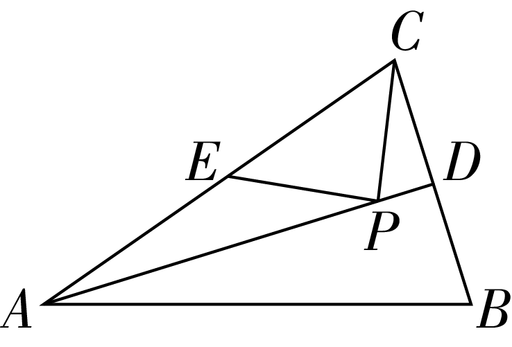

# Mathematics - 题目 2950

**ID**: 7f02d48ad591451abe0715f0dec4c0c6
**年级**: Grade 8
**难度**: Medium-Hard
**题型**: 刷提升

## 题目
（新考法）如图，在△ABC中，AB＝AC＝13，AD＝12，BC＝10，AD平分∠BAC，E是线段AC上的动点，P是线段AD上的动点，则△ABC的面积为，PC＋PE的最小值为．​​​​​​​‌

## 解答

1. ∵AB＝AC，AD平分∠BAC，∴AD⊥BC，AD为BC边上的中线，∴S_{△}_{ABC}＝ $\frac{1}{2}$ ×BC×AD＝ $\frac{1}{2}$ ×10×12＝60.如图，∵AD为BC的垂直平分线，∴E关于AD的对称点E′在AB上，连接CE′交AD于点P，过C作CH⊥AB于H，交AD于P′，PC＋PE＝PE′＋PC＝CE′⩾CH，∴PC＋PE的最小值为CH，此时，E′与H重合，P与P′重合，E为H关于AD的对称点．∵CH⊥AB，∴S_{△}_{ABC}＝ $\frac{1}{2}$ ×AB×CH＝ $\frac{1}{2}$ ×13×CH＝ $\frac{13}{2}$CH，∴ $\frac{13}{2}$CH＝60，∴CH＝ $\frac{120}{13}$ ，∴PC＋PE的最小值为 $\frac{120}{13}$ .故答案为60， $\frac{120}{13}$ .
2. 
3. 【关键点拨】
4. 利用等腰三角形的对称性，将E点转换到AB上，从而利用垂线段最短的性质求得PE＋PC的最小值.

## 知识点

**中文**:
  - 等腰三角形的性质
  - 线段垂直平分线的性质

**English**:
  - Properties of Isosceles Triangles
  - Properties of Perpendicular Bisectors

---
