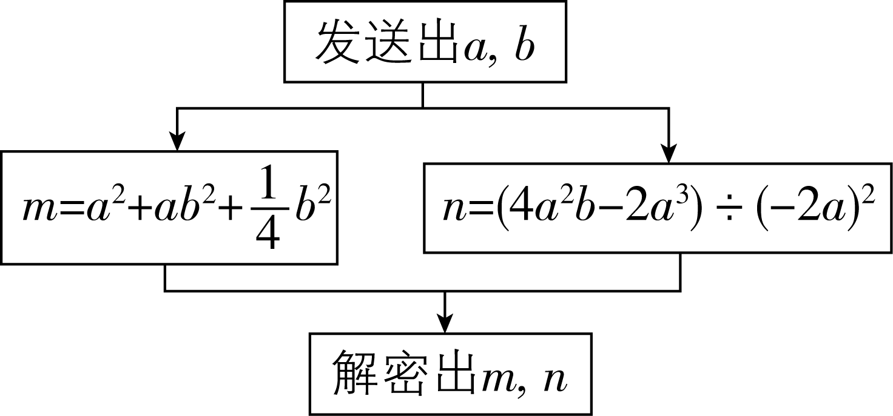

# Mathematics - 题目 2418

**ID**: dc5c40fddd7c4925a4a572fba3cc52cb
**年级**: Grade 8
**难度**: Medium-Hard
**题型**: 刷提升

## 题目
（新考法）信息时代确保信息的安全很重要，于是在传输信息的时候需要加密传输，发送方将明文加密为密文传输给接收方，接收方收到密文后解密还原为明文．已知某种加密规则如图所示，当发送方发出a＝2，b＝4，则解密后明文的值mn＝.​​​​​​​‌

## 解答

1. n＝(4a^{2}b－2a^{3})÷(－2a)^{2}＝(4a^{2}b－2a^{3})÷4a^{2}＝b－ $\frac{1}{2}$a.将a＝2，b＝4代入m，n得m＝a^{2}＋ab^{2}＋ $\frac{1}{4}$b^{2}＝2^{2}＋2×4^{2}＋ $\frac{1}{4}$ ×4^{2}＝4＋32＋4＝40，n＝b－ $\frac{1}{2}$a＝4－ $\frac{1}{2}$ ×2＝3，∴mn＝40×3＝120.故答案为120.

## 知识点

**中文**:
  - 多项式除以单项式

**English**:
  - Polynomial divided by Monomial

---
