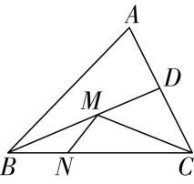

# Mathematics - 题目 1141

**ID**: 0dd99cf8b94c40b4b553e45205f5aeed
**年级**: Grade 8
**难度**: Medium
**题型**: Multiple-choice

## 题目
如图，在锐角三角形 $ABC$ 中， $AB=4$ ， $△ABC$ 的面积为 ${\rm 8，}BD$ 平分 $\mathrm{\angle }ABC$ .​​​​​​​‌若 $M$ ， $N$ 分别是 $BD$ ， $BC$ 上的动点，则 $CM+MN$ 的最小值是（      ）（第4题图）

## 解答

1. 如图，过点 $C$ 作 $CE\perp AB$ ，垂足为点 $E$ ，交 $BD$ 于点 $M\prime $ ，过点 $M\prime $ 作 $M\prime N\prime \perp BC$ ，垂足为点 $N\prime .\because BD$ 平分 $\mathrm{\angle }ABC$ ， $\therefore M\prime N\prime =M\prime E$ ， $\therefore CM\prime +M\prime N\prime =CE$ ， $\therefore $  当点 $M$ 与点 $M\prime $ 重合时， $CM+MN$ 的值最小，等于 $CE$ 的长 ${\rm .}\because AB=4$ ， $△ABC$ 的面积为 ${\rm 8，}\therefore {S}_{△ABC}=\frac{1}{2}AB\cdot CE=\frac{1}{2}×4CE=8$ ， $\therefore CE=4$ ， $\therefore CM+MN$ 的最小值为4，故选 $\mathrm{B}$ .
2. 

## 知识点

**中文**:
  - 最短路径问题
  - 轴对称的性质

**English**:
  - Shortest Path Problems
  - Properties of Axial Symmetry

---
