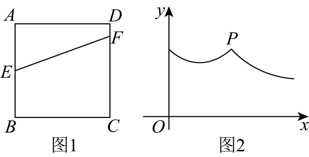

# Mathematics - 题目 1729

**ID**: 0fdc186881ec4bafbafebce9ec572d83
**年级**: Grade 8
**难度**: Medium
**题型**: Multiple-choice

## 题目
如图1，在面积为4的正方形 $ABCD$ 中，E为 $AB$ 边的中点，动点F从点D出发，在正方形的边上沿 $D\to C\to B$ 匀速运动，运动到点B时停止．设点F的运动路程为x，线段 $EF$ 的长为y，y与x的函数图象如图2所示，则点P的坐标为（      ）​​​​​​​‌

## 解答

1. 解：连接 $CE$ ,
2. 当点F在边 $CD$ 上时，y的值先减小后增大，
3. 当点F在边 $BC$ 上时，y的值逐渐减小，
4. $\therefore $ 点P的横坐标为 $CD$ 的长，纵坐标为 $CE$ 的长,
5. $\because $ 正方形 $ABCD$ 的面积为4，
6. $\therefore AB=BC=CD=\sqrt {4}=2$ ，
7. $\because $  $E$ 是 $AB$ 的中点，
8. $\therefore BE=\frac {1}{2}AB=\frac {1}{2}\times 2=1$ ,
9. 在 ${\rm{R}}{\rm{t}}\vartriangle BCE$ 中，由勾股定理得 $CE=\sqrt {BC{^{2}}+BE{^{2}}}=\sqrt {2{^{2}}+1{^{2}}}=\sqrt {5}$ ，
10. $\therefore $ 点P的坐标为 $\left ({2,\sqrt {5}}\right )$ ，
11. 故选D．

## 知识点

**中文**:
  - 从函数的图象获取信息
  - 动点问题的函数图象

**English**:
  - Extracting Information from Graphs
  - Graphs of Moving Point Problems

---
