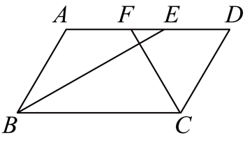

# Mathematics - 题目 96

**ID**: 173c5e3b160848e88d488d8c420cc479
**年级**: Grade 8
**难度**: Medium
**题型**: Multiple-choice

## 题目
如图，在 $▱ABCD$ 中， $∠ABC$ 与 $\angle BCD$ 的平分线 $BE$ ， $CF$ 分别与 $AD$ 相交于点 $E$ ， $F$ ．若 $AB=6$ ， $AD=10$ ，则 $EF$ 的长为（      ）​​​​​​​‌

## 解答

1. ∵四边形 $ABCD$ 是平行四边形，
2. ∴ $CD=AB=6$ ， $AD{\rm{/\mskip-4mu/}}BC$ ．
3. ∴ $\angle AEB=\angle CBE$ ．
4. ∵ $BE$ 平分 $∠ABC$ ，
5. $\therefore \angle ABE=\angle CBE$ ．
6. $\therefore \angle ABE=\angle AEB$ ．
7. $\therefore AE=AB=6$ ．
8. 同理 $DF=CD=6$ ．
9. $\because AD=10$ ，
10. $\therefore DE=AD-AE=10-6=4$ ，
11. $\therefore EF=DF-DE=6-4=2$ ．
12. 故此题答案为D．

## 知识点

**中文**:
  - 平行四边形的对边平行且相等
  - 角平分线
  - 等腰三角形的判定

**English**:
  - Opposite Sides Parallel and Equal
  - Angle Bisector
  - Determination of Isosceles Triangles

---
