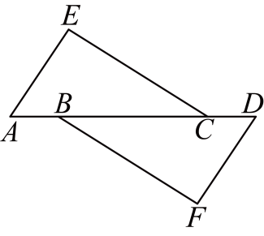

# Mathematics - 题目 562

**ID**: 19a5649558df44298a1fa07f8ba100d9
**年级**: Grade 8
**难度**: Medium
**题型**: Multiple-choice

## 题目
如图， $AE\parallel DF$ ， $AE=DF$ ．添加下列条件中的一个：① $AB=CD$ ；​​​​​​​‌② $\angle E=\angle F$ ；③ $EC=BF$ ；④ $EC\mathrm{/\mskip-4mu/}BF$ ．其中可以得到 $△ACE{\rm{≌}}△DBF$ 的是（      ）

## 解答

1. 解： $\because AE\mathrm{/\mskip-4mu/}DF$ ，
2. $\therefore \angle A=\angle D$ ，
3. $\because AB=CD$ ，
4. $\therefore AB+BC=CD+BC$ ，即 $AC=DB$ ，
5. $\because AE=DF$ ，
6. $\therefore \vartriangle ACE≌\vartriangle DBF\left ({{\rm{S}}{\rm{A}}{\rm{S}}}\right )$ ，
7. 故①能证明 $\vartriangle ACE≌\vartriangle DBF$ ；
8. $\because AE\mathrm{/\mskip-4mu/}DF$ ， $AE=DF$ ,
9. $\therefore \angle A=\angle D$ ，
10. $\because \angle E=\angle F$ ，
11. $\therefore \vartriangle ACE≌\vartriangle DBF\left ({{\rm{A}}{\rm{S}}{\rm{A}}}\right )$ ，
12. 故②能证明 $\vartriangle ACE\mathrm{≌}\vartriangle DBF$ ；
13. $\because AE\mathrm{/\mskip-4mu/}DF$ ，
14. $\therefore \angle A=\angle D$ ，
15. $\because AE=DF$ ， $EC=FB$ ，
16. 而： ${\rm{S}}{\rm{S}}{\rm{A}}$ 不能判定三角形全等，故③不能；
17. $\because AE\mathrm{/\mskip-4mu/}DF$ ，
18. $\therefore \angle A=\angle D$ ，
19. $\because EC/\mskip-4mu/BF$ ，
20. $\therefore \angle ECA=\angle FBD$ ，
21. $\therefore \vartriangle ACE≌\vartriangle DBF\left ({{\rm{A}}{\rm{A}}{\rm{S}}}\right )$ ，
22. 故④能证明 $\vartriangle ACE\mathrm{≌}\vartriangle DBF$ ；
23. 故此题答案为A．

## 知识点

**中文**:
  - 角角边(AAS)
  - 边角边(SAS)
  - 角边角(ASA)
  - 边边边(SSS)

**English**:
  - AAS (Angle-Angle-Side)
  - SAS (Side-Angle-Side)
  - ASA (Angle-Side-Angle)
  - SSS (Side-Side-Side)

---
