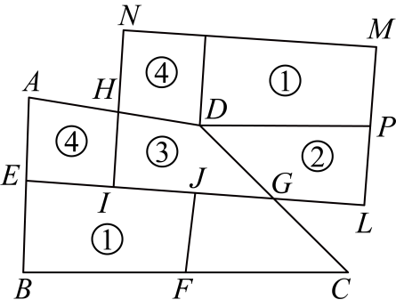

# Mathematics - 题目 2451

**ID**: 2ced1864410c46f2b1bbb66bef5dc9ba
**年级**: Grade 8
**难度**: Medium
**题型**: Multiple-choice

## 题目
如图，已知四边形纸片 $ABCD{\rm ，\mathit{E}，\mathit{F}，\mathit{G}，\mathit{H}}$ 是四条边上的中点，连结 $EG$ ，分别过点H，F作 $HI\bot EG$ 于点 ${\rm \mathit{I}，}FJ\bot EG$ 于点J，沿 $EG$ ， $HI$ ， $FJ$ 将四边形纸片 $ABCD$ 剪成四个小四边形纸片，记为①，②，③，④，将这四张纸片恰好可以无重叠、无缝隙地拼成一个新的四边形纸片 $ILMN$  (①沿 $BD$ 方向平移，④和②分别绕点H和点G旋转 $180{}\degree $ )．若 $EJ=5{\rm{c}}{\rm{m}}$ ， $JG=2{\rm{c}}{\rm{m}}$ ， $FJ=3{\rm{c}}{\rm{m}}$ ，则四边形 $ILMN$ 的周长是（      ）​​​​​​​‌

## 解答

1. 解：如图，
2. 
3. 由题可知 $FJ=PM=PL=3{\rm{c}}{\rm{m}}$ ， $JG=GL=2{\rm{c}}{\rm{m}}$ ， $MQ=EJ=5{\rm{c}}{\rm{m}}$ ，
4. 设 $JI=x{\rm{c}}{\rm{m}}$ ，则 $NQ=EI=EJ-JI=\left ({5-x}\right ){\rm{c}}{\rm{m}}$ ，
5. $\therefore NQ=EI=\left ({5-x}\right ){\rm{c}}{\rm{m}}$ ，
6. $\therefore $ 矩形周长为 $=MN+ML+LI+NI=5-x+5+6+4+x+6=26{\rm{c}}{\rm{m}}$ ．
7. 故选B．

## 知识点

**中文**:
  - 平移的性质
  - 旋转的性质

**English**:
  - Properties of Translation
  - Properties of Rotation

---
