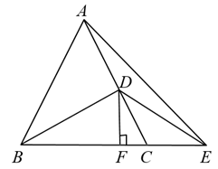

# Mathematics - 题目 2340

**ID**: 2e6407c225d64791a29cd60b86aeeabf
**年级**: Grade 8
**难度**: Medium
**题型**: Multiple-choice

## 题目
如图，在等边三角形ABC中，D为AC边的中点，E为边BC延长线上一点 ${\rm ．}BD=DE$ ， $DF\bot BE$ 垂足为点F．下列结论：① $AD=CE$ ；​​​​​​​‌② $\angle BDE=120{}\degree $ ；③ $CF:BF=1:3$ ；④ $S{{}_{ΔCDE}}=\frac {1}{6}S{{}_{ΔABE}}$ ．其中正确的有（      ）

## 解答

1. 解：∵ ${\rm △\mathit{ABC}}$ 是等边三角形，AD＝DC，
2. ∴BD⊥AC，BD平分 ${\rm ∠\mathit{ABC}}$ ，
3. ∵ ${\rm ∠\mathit{ABC}＝∠\mathit{ACB}＝60°}$ ，
4. ∴ ${\rm ∠\mathit{DBC}＝30°}$ ，
5. ∵DB＝DE，
6. ∴ ${\rm ∠\mathit{DBC}＝∠\mathit{DEC}＝30°}$ ，
7. ∵ ${\rm ∠\mathit{ACB}＝∠\mathit{CDE}+∠\mathit{CED}}$ ，
8. ∴ ${\rm ∠\mathit{CDE}＝∠\mathit{CED}＝30°}$ ，
9. ∴CD＝CE＝AD，故①正确；
10. ∵ ${\rm ∠\mathit{BDC}＝90°，∠\mathit{CDE}＝30°}$ ，
11. ∴ ${\rm ∠\mathit{BDE}＝∠\mathit{BDC}+∠\mathit{CDE}＝120°}$ ，故②正确；
12. ∵DF⊥CB，
13. ∴ ${\rm ∠\mathit{CDF}＝30°}$ ，
14. ∴CD＝2CF，BC＝2CD，
15. ∴BC＝4CF，
16. ∴BF＝3CF，故③正确；
17. ∴BC＝2CE，
18. ∴S_{△}BCD＝2S_{△}DEC，
19. ∵AD＝DC，
20. ∴S_{△}ABD＝S_{△}CBD＝2S_{△}CDE，S_{△}ADC＝S_{△}CDE，
21. ∴S_{△}ABE＝6S_{△}CDE，故④正确．
22. 故选D.

## 知识点

**中文**:
  - 含30度角的直角三角形
  - 等腰三角形的判定与性质
  - 等边三角形的性质

**English**:
  - Right Triangle with 30° Angle
  - Determination and Properties
  - Properties of Equilateral Triangles

---
