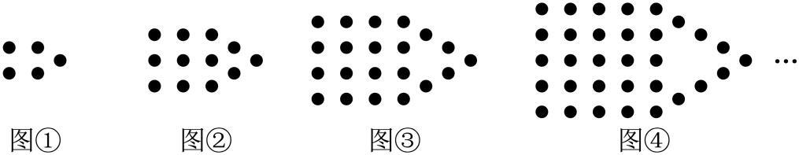

# Mathematics - 题目 3313

**ID**: 2e6bfb91cb084b34bbf578d59b4f1023
**年级**: Grade 8
**难度**: Medium
**题型**: Multiple-choice

## 题目
某同学用大小相同的黑色棋子摆成如图所示的图形，图①由5颗棋子组成，图②由12颗棋子组成，图③由21颗棋子组成，……，按照这一规律，图⑦用的棋子数量是（      ）​​​​​​​‌

## 解答

1. 解：∵第一个图形右面是 $1$ 个棋子，左面是 $4$ 个棋子，第二个图形右面是 $3$ 个棋子，左面是 $9$ 个棋子，第三个图形右面是 $5$ 个棋子，左面是 $16$ 个棋子，…
2. ∴第 $n$ 个图形右面是 $\left ({2n-1}\right )$ 个棋子，左面是 ${\left({n+1}\right)^{2}}$ 个棋子；
3. ∴第n个图形用的棋子数是 ${\left({n+1}\right)^{2}}+2n-1=n{^{2}}+4n$ ；
4. 当 $n=7$ 时， $n{^{2}}+4n=49+28=77$
5. 故选A．

## 知识点

**中文**:
  - 规律型：图形的变化类

**English**:
  - Patterns: Geometric Variations

---
