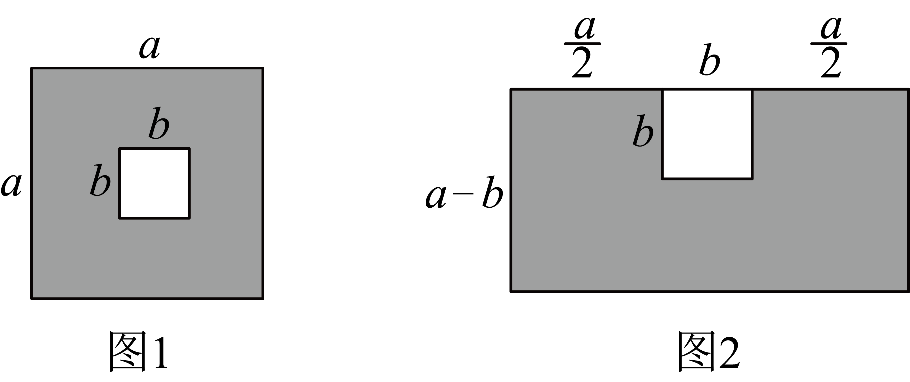

# Mathematics - 题目 3987

**ID**: 6e68c3aff98d41e0b00aeec72e834d65
**年级**: Grade 8
**难度**: Medium
**题型**: Multiple-choice

## 题目
图1是由两个正方形构成的回字形，阴影部分的面积记为 $S{{}_{1}}$ ．图2是由长方形和正方形构成的凹字形，阴影部分的面积记为 $S{{}_{2}}$ ．则 $S{{}_{1}}$ 与 $S{{}_{2}}$ 的大小关系为（      ）​​​​​​​‌

## 解答

1. 解：由题意得：
2. $S{{}_{1}}=a{^{2}}-b{^{2}}$ ；
3. $S{{}_{2}}=\left ({a-b}\right )\left ({\frac {a}{2}+b+\frac {a}{2}}\right )-b{^{2}}$
4. $=\left ({a-b}\right )\left ({a+b}\right )-b{^{2}}$
5. $=a{^{2}}-b{^{2}}-b{^{2}}$
6. $=a{^{2}}-2b{^{2}}$ ；
7. $\therefore S{{}_{1}}-S{{}_{2}}=a{^{2}}-b{^{2}}-\left ({a{^{2}}-2b{^{2}}}\right )$
8. $=a{^{2}}-b{^{2}}-a{^{2}}+2b{^{2}}$
9. $=b{^{2}}>0$ ，
10. $\therefore S{{}_{1}}>S{{}_{2}}$ ，
11. 故选A．

## 知识点

**中文**:
  - 列代数式
  - 整式的混合运算

**English**:
  - Writing Algebraic Expressions
  - Mixed Operations of Polynomials

---
