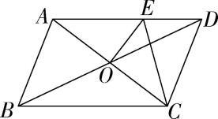

# Mathematics - 题目 2214

**ID**: 7953cd08529f4654a9283900ff6ad466
**年级**: Grade 8
**难度**: Medium
**题型**: Multiple-choice

## 题目
如图， $▱ABCD$ 的周长为 $8\mathrm{c}\mathrm{m}$ ，对角线 $AC$ 与 $BD$ 相交于点 $O$ ， $OE\perp AC$ 交 $AD$ 于 $E$ ，连接 $CE$ ，则 $△DCE$ 的周长为（      ）​​​​​​​‌

## 解答

1. $\because $  四边形 $ABCD$ 是平行四边形，对角线 $AC$ 与 $BD$ 相交于点 $O$ ， $\therefore AO=CO$ ， $AD=BC$ ， $AB=CD.\because $  平行四边形 $ABCD$ 周长为 $8\mathrm{c}\mathrm{m}$ ， $\therefore DC+AD=4\mathrm{c}\mathrm{m}$ . $\because OE\perp AC$ ， $\therefore AE=CE$ ， $\therefore △DCE$ 的周长为 $DC+DE+CE=DC+DE+AE=DC+AD=4\mathrm{c}\mathrm{m}$ ，故选 $\mathrm{B}$ .

## 知识点

**中文**:
  - 平行四边形的对角线互相平分
  - 平行四边形的对边平行且相等
  - 线段垂直平分线的性质

**English**:
  - Diagonals Bisect Each Other
  - Opposite Sides Parallel and Equal
  - Properties of Perpendicular Bisectors

---
