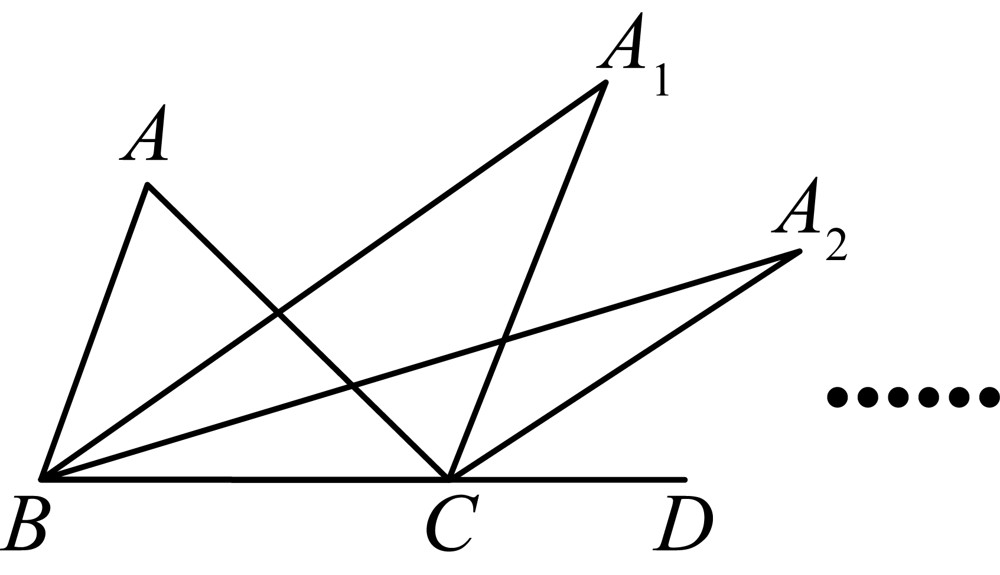

# Mathematics - 题目 2671

**ID**: aa7a569616734724a4f1d0a9239971e4
**年级**: Grade 8
**难度**: Medium
**题型**: Multiple-choice

## 题目
如图，在 $\vartriangle ABC$ 中， $\angle A=64{}\degree $ ， $∠ABC$ 与 $\angle ACD$ 的平分线交于点 $A{{}_{1}}$ ， $\angle A{{}_{1}}BC$ 与 $\angle A{{}_{1}}CD$ 的平分线相交于点 $A{{}_{2}}$ ，…依次进行下去， $\angle A{{}_{n-1}}BC$ 与 $\angle A{{}_{n-1}}CD$ 的平分线相交于点 $A{{}_{n}}$ ，要使 $\angle A{{}_{n}}$ 的度数小于 $1{}\degree $ ，则 $n$ 的最小值为（      ）​​​​​​​‌

## 解答

1. 解： $\because A{{}_{1}}B$ 是 $∠ABC$ 的平分线， $CA{{}_{1}}$ 是 $\angle ACD$ 的平分线，
2. $\therefore \angle ABA{{}_{1}}=\angle A{{}_{1}}BC=\frac {1}{2}\angle ABC$ ， $\angle ACA{{}_{1}}=\angle A{{}_{1}}CD=\frac {1}{2}\angle ACD$ ，
3. $\therefore \angle A{{}_{1}}=\angle A{{}_{1}}CD-\angle A{{}_{1}}BC$
4. $=\frac {1}{2}\angle ACD-\frac {1}{2}\angle ABC$
5. $=\frac {1}{2}\left ({\angle ABC+\angle A}\right )-\frac {1}{2}\angle ABC$
6. $=\frac {1}{2}\angle A$ ，
7. 同理， $\angle A{{}_{2}}=\frac {1}{2}\angle A{{}_{1}}=\frac {1}{2{^{2}}}\angle A$ ，
8. $\angle A{{}_{3}}=\frac {1}{2}\angle A{{}_{2}}=\frac {1}{2{^{3}}}\angle A$ ，
9. $\angle A{{}_{4}}=\frac {1}{2}\angle A{{}_{3}}=\frac {1}{2{^{4}}}\angle A$ ，
10. ……
11. $\therefore \angle A{{}_{n}}=\frac {1}{2}\angle A{{}_{n-1}}=\frac {1}{2{^{n}}}\angle A$ ，
12. 当 $\angle A{{}_{n}}<1{}\degree $ 时，则 $\frac {1}{2{^{n}}}\times 64<1$ ，
13. $\therefore n>6$ ，
14. 又∵n为正整数，
15. 即 $n$ 最小值为7．
16. 故选C．

## 知识点

**中文**:
  - 三角形的外角性质
  - 角平分线

**English**:
  - Exterior Angle Properties
  - Angle Bisector

---
