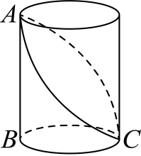

# Mathematics - 题目 963

**ID**: b7902090c64f4ad8a777f0659ac65b77
**年级**: Grade 8
**难度**: Medium
**题型**: Multiple-choice

## 题目
如图，已知圆柱的底面直径 ${\rm \mathit{BC}=}\frac {6}{π}$ ，高AB=3，小虫在圆柱表面爬行，从C点爬到A点，然后再沿另一面爬回C点，则小虫爬行的最短路程为（      ）​​​​​​​‌

## 解答

1. 把圆柱侧面展开，展开图如右图所示，点A、C的最短距离为线段AC的长．
2. 
3. 在RT△ADC中，∠ADC=90°，CD=AB=3，AD为底面半圆弧长，AD=3，所以 ${\rm \mathit{AC}=}3\sqrt {2}$ ，∴从C点爬到A点，然后再沿另一面爬回C点，则小虫爬行的最短路程为 ${\rm 2\mathit{AC}=}6\sqrt {2}$ ．

## 知识点

**中文**:
  - 两点间的距离
  - 几何体的展开图

**English**:
  - Distance Between Two Points
  - Nets of Geometric Solids

---
