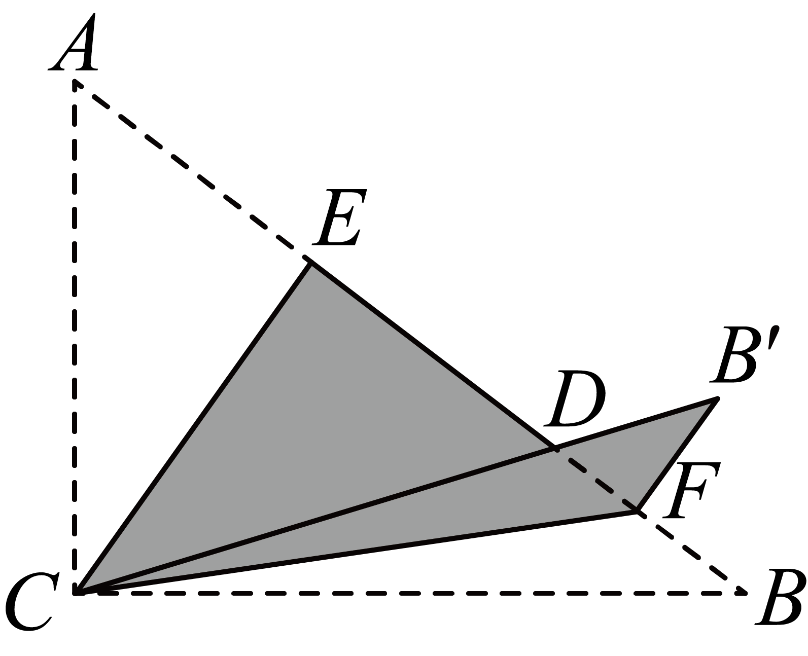

# Mathematics - 题目 2432

**ID**: dc6fa6cf5eeb4a7ca96831b538e686b7
**年级**: Grade 8
**难度**: Medium
**题型**: Multiple-choice

## 题目
如图， ${\rm{R}}{\rm{t}}\mathrm{△}ABC$ 中， $\angle ACB\mathrm{=}90{}\degree $ ， $AC=3$ ， $BC=4$ ， $AB=5$ ，将边 $AC$ 沿 $CE$ 翻折，使点 $A$ 落在 $AB$ 上的点 $D$ 处；​​​​​​​‌再将边 $BC$ 沿 $CF$ 翻折，使点 $B$ 落在 $CD$ 的延长线上的点 $B^\prime $ 处，两条折痕与斜边 $AB$ 分别交于点 $E$ 、 $F$ ，则 $AE+BF$ 的值为（      ）

## 解答

1. 解：∵翻折，
2. ∴ $CE\bot AD$ ， $\angle ACE=\angle DCE,\angle BCF=\angle DCF$ ，
3. ∴ $\angle ACE+\angle DCE+\angle DCF+\angle BCF=2\left ({\angle DCE+\angle DCF}\right )=2\angle ECF=\angle ACB=90{}\degree $ ，
4. ∴ $\angle ECF=45{}\degree $ ，
5. ∴ $\mathrm{△}ECF$ 为等腰直角三角形，
6. ∴ $CE=EF$ ，
7. ∵ $S{{}_{\mathrm{△}ABC}}=\frac {1}{2}AC\cdot BC=\frac {1}{2}AB\cdot CE$ ，
8. ∴ $3\times 4=5CE$ ，
9. ∴ $CE=\frac {12}{5}$ ，
10. ∴ $EF=CE=\frac {12}{5}$ ，
11. ∴ $AE+BF=AB-EF=5-\frac {12}{5}=\frac {13}{5}$ ；
12. 故选A．

## 知识点

**中文**:
  - 折叠问题
  - 等腰直角三角形的性质

**English**:
  - Folding Problems
  - Properties of Isosceles Right Triangles

---
