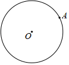

# Mathematics - 题目 111

**ID**: 0c451483dcca4c8a8f17a22ce39bd7d7
**年级**: Grade 9
**难度**: Easy
**题型**: Calculation

## 题目
如图， $\odot O$ 的半径是5，点 $A$ 在 $\odot O$ 上． $P$ 是 $\odot O$ 所在平面内一点，且 $AP=2$ ，过点 $P$ 作直线 $l$ ，使 $l\bot PA$ ．（1）点 $O$ 到直线 $l$ 距离的最大值为；​​​​​​​‌（2）若 $M$ ， $N$ 是直线 $l$ 与 $\odot O$ 的公共点，则当线段 $MN$ 的长度最大时， $OP$ 的长为．

## 解答

1. 解：（1）如图1， $\because l\bot PA$ ，
2. 
3. $\therefore $ 当点 $P$ 在圆外且 $O,A,P$ 三点共线时，点 $O$ 到直线 $l$ 距离的最大，
4. 此时最大值为 $AO+AP=5+2=7$ ，
5. 故答案为：7；
6. （2）如图2， $\because M,N$ 是直线 $l$ 与 $\odot O$ 的公共点，当线段 $MN$ 的长度最大时，线段 $MN$ 是 $\odot O$ 的直径，
7. 
8. $\because l\bot PA$ ，
9. $\therefore \angle APO=90{}^\circ $ ，
10. $\because AP=2$ ， $OA=5$ ，
11. $\therefore OP=\sqrt {OA{^{2}}-PA{^{2}}}=\sqrt {21}$ ，
12. 故答案为： $\sqrt {21}$ ．

## 知识点

**中文**:
  - 直线和圆的位置关系

**English**:
  - Line and Circle Relationship

---
