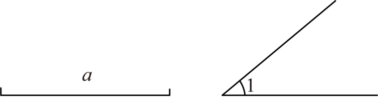

# Mathematics - 题目 2645

**ID**: 220b12ea589f4ce5884943bcdf5641df
**年级**: Grade 9
**难度**: Easy
**题型**: Calculation

## 题目
如图，已知：线段 $a$ 和 $\angle 1$ ．求作：菱形 $ABCD$ ，使对角线 $AC=a$ ， $\angle BAD=\angle 1$ ．​​​​​​​‌

## 解答

1. 解：如图，菱形 $ABCD$ 即为所求，使对角线 $AC=a$ ， $\angle BAD=\angle 1$ ．
2. 

## 知识点

**中文**:
  - 尺规作图——作线段垂直平分线
  - 尺规作图——作角
  - 菱形的判定

**English**:
  - Construction: Perpendicular Bisector
  - Construction: Drawing an Angle
  - Determination of Rhombuses

---
