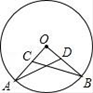

# Mathematics - 题目 2952

**ID**: 29b7c69557524fb08dd5326d2682ca67
**年级**: Grade 9
**难度**: Easy
**题型**: Calculation

## 题目
已知；​​​​​​​‌如图，在⊙O中，C、D分别是半径OA、BO的中点，求证：AD＝BC．

## 解答

1. 解：∵OA、OB是⊙O的两条半径，
2. ∴AO＝BO，
3. ∵C、D分别是半径OA、BO的中点，
4. ∴OC＝OD，
5. 在△OCB和△ODA中，
6. $\left \{\hspace{-0.5em}\begin{array}{l}\hspace{-0.5em}\begin{array}{l}AO＝BO\\\angle O＝\angle O\\OD＝OC\end{array}\hspace{-0.5em}&\end{array}\hspace{-0.5em}，\right.$
7. ∴△OCB≌△ODA（SAS），
8. ∴AD＝BC．

## 知识点

**中文**:
  - 圆的基本认识

**English**:
  - Basic Concepts of Circles

---
