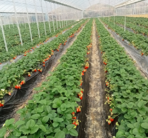
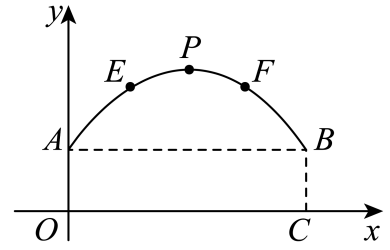

# Mathematics - 题目 2994

**ID**: 3028e7fd13424fffb1d6aea328b65afb
**年级**: Grade 9
**难度**: Easy
**题型**: Calculation

## 题目
综合实践草莓种植大棚的设计生活背景草莓种植大棚是一种具有保温性能的框架结构．如图示，一般使用钢结构作为骨架，上面覆上一层或多层塑料膜，这样就形成了一个温室空间．建立模型如图，已知某草莓园的种植大棚横截面由抛物线 $APB$ 和矩形 $OABC$ ，其中点 $P$ 为抛物线的顶点，大棚最高处离地面 $4{\rm{m}}$ ，宽 $OC=8{\rm{m}}{\rm \mathit{，}}$  $OA=2{\rm{m}}$ ．现以点 $O$ 为坐标原点， $OC$ 所在直线为 $x$ 轴， $OA$ 所在直线为 $y$ 轴建立平面直角坐标系．任务一求抛物线 $APB$ 的解析式．任务二已知，照明灯 $E、F$ 到地面的距离均为 $3{\rm{m}}{\rm \mathit{，}}$ 求灯 $E、F$ 之间的水平距离．​​​​​​​‌

## 解答

1. 解：任务一：由题意得抛物线的顶点为 $\left ({4,4}\right )$ ，
2. ∴设抛物线的解析式为 $y=a{\left({x-4}\right)^{2}}+4$ ，
3. 又∵抛物线过 $(0,2)$ ，
4. ∴ $2=16a+4$ ，
5. ∴ $a=-\frac {1}{8}$ ，
6. ∴抛物线的解析式为 $y=-\frac {1}{8}{\left({x-4}\right)^{2}}+4$ ；
7. 任务二：当 $y=3$ 时，即 $-\frac {1}{8}{\left({x-4}\right)^{2}}+4=3$ ，
8. 解得： $x=4\pm 2\sqrt {2}$ ，
9. ∴ $E、F$ 的横坐标分别为 $4-2\sqrt {2}$ ， $4+2\sqrt {2}$ ，
10. ∴ $EF=4\sqrt {2}{\rm{m}}$ ，
11. 答：两灯间的水平距离为 $4\sqrt {2}{\rm{m}}$ ．

## 知识点

**中文**:
  - 其他问题

**English**:
  - Other Problems

---
