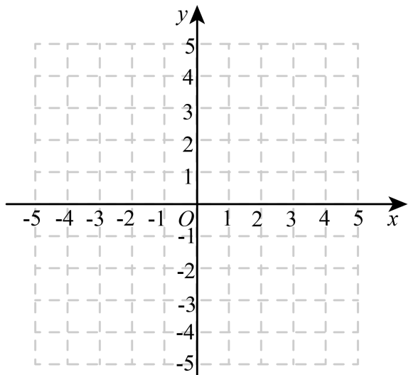

# Mathematics - 题目 2552

**ID**: 307a7b8123224b5aa2752afd5cc74471
**年级**: Grade 9
**难度**: Easy
**题型**: Calculation

## 题目
已知二次函数 $y{\rm{=}}x{^{{{2}}}}-{{2}}x-{{3}}$ ．请解答下列问题：(1)在平面直角坐标系 $xOy$ 中，画出这个二次函数的图象（不用列表）：(2)此函数图象与 $x$ 轴的交点坐标为．(3)直接写出当 $y>0$ 时，x的取值范围．​​​​​​​‌

## 解答

1. （1）解：列表如下：
2. x
3. …
4. $-1$
5. 0
6. 1
7. 2
8. 3
9. …
10. y
11. …
12. 0
13. $-3$
14. $-4$
15. $-3$
16. 0
17. …
18. $y{\rm{=}}x{^{{{2}}}}-{{2}}x-{{3}}$ 的图象如下：
19. ；
20. （2）解：当 $y=0$ 时， $x{^{2}}-2x-3=0$ ，
21. 解得 $x{{}_{1}}=-1$ ， $x{{}_{2}}=3$ ，
22. ∴函数图象与 $x$ 轴的交点坐标为 $\left ({-1,0}\right )$ ， $\left ({3,0}\right )$
23. （3）解：由图象可知，当 $y>0$ 时， $x<-1$ 或 $x>3$ ．

## 知识点

**中文**:
  - y=ax²+bx+c的图象与性质
  - 用描点法画函数图象

**English**:
  - Graph and Properties of y=ax²+bx+c
  - Plotting Graphs by Points

---
