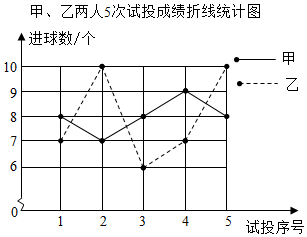

# Mathematics - 题目 3423

**ID**: 3396ddd6e0a5463ea411609c5f76d92e
**年级**: Grade 9
**难度**: Easy
**题型**: Calculation

## 题目
某班为了从甲、乙两名同学中选出一名同学代表班级参加学校的投篮比赛，对甲、乙两人进行了5次投篮试投比赛，试投每人每次投球10个．两人5次试投的成绩统计图如图所示．（1）甲同学5次试投进球个数的众数是多少？（2）求乙同学5次试投进球个数的平均数；​​​​​​​‌（3）不需计算，请根据折线统计图判断甲、乙两名同学谁的投篮成绩更加稳定？（4）学校投篮比赛的规则是每人投球10个，记录投进球的个数．由往届投篮比赛的结果推测，投进8个球即可获奖，但要取得冠军需要投进10个球．请你根据以上信息，从甲、乙两名同学中推荐一名同学参加学校的投篮比赛，并说明推荐的理由．

## 解答

1. 解：（1）∵甲同学5次试投进球个数分别为8,7,8,9,8，
2. ∴甲同学5次试投进球个数的众数是8个，
3. （2）乙同学5次试投进球个数分别为7,10,6,7,10，
4. ∴ $\bar x=\frac {1}{5}\left ({7+10+6+7+10}\right )=8$ 个；
5. （3）根据折线统计图甲投篮成绩波动较小，折线统计图乙投篮成绩波动较大，
6. ∴甲投篮成绩更加稳定；
7. （4）∵乙的众数是10，取得冠军需要投进10个球，而甲没有进10球的可能，为了能获得冠军，推荐乙参加投篮比赛．

## 知识点

**中文**:
  - 众数
  - 折线统计图
  - 算术平均数

**English**:
  - Mode
  - Line Charts
  - Arithmetic Mean

---
