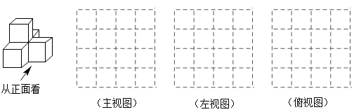

# Mathematics - 题目 133

**ID**: 4812578fa7814229926d6931172c2855
**年级**: Grade 9
**难度**: Easy
**题型**: Calculation

## 题目
如图所示的几何体是由5个大小完全相同的小立方块搭成的，请你在网格中画出该几何体的主视图、左视图和俯视图．​​​​​​​‌

## 解答

1. 解：如图所示：
2. ．

## 知识点

**中文**:
  - 画三视图

**English**:
  - Drawing Three Views

---
